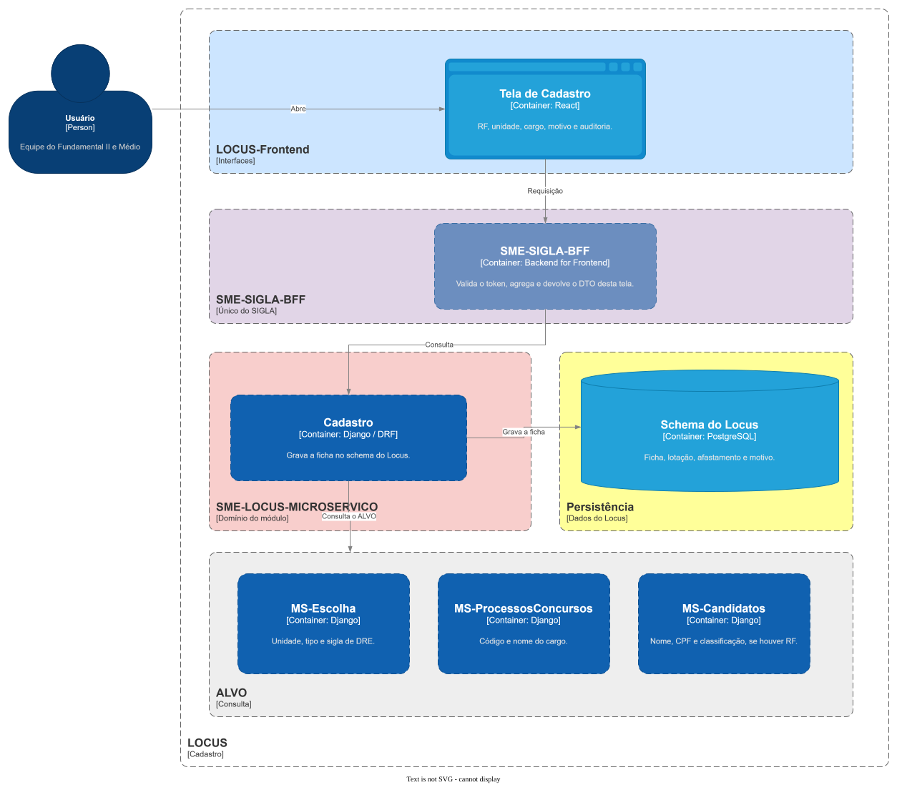
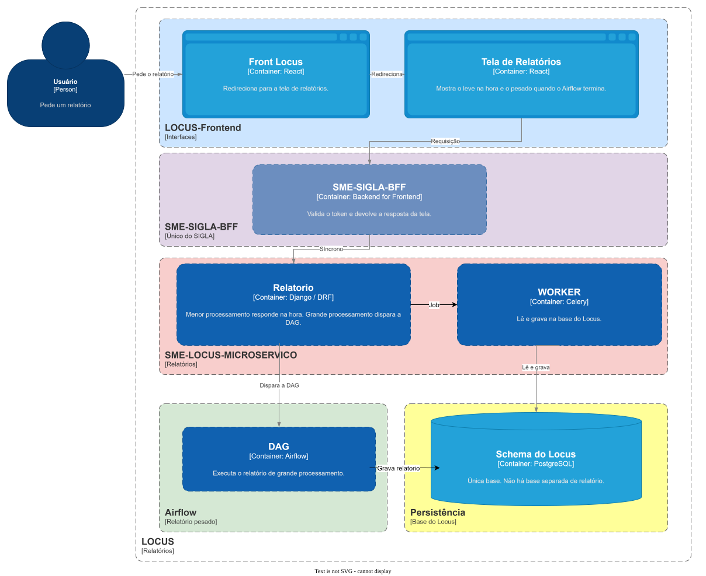
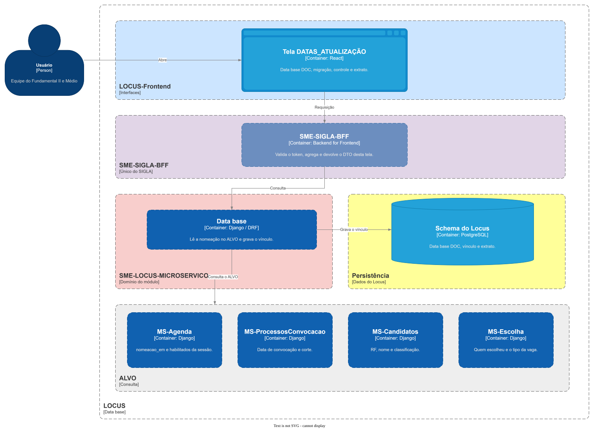
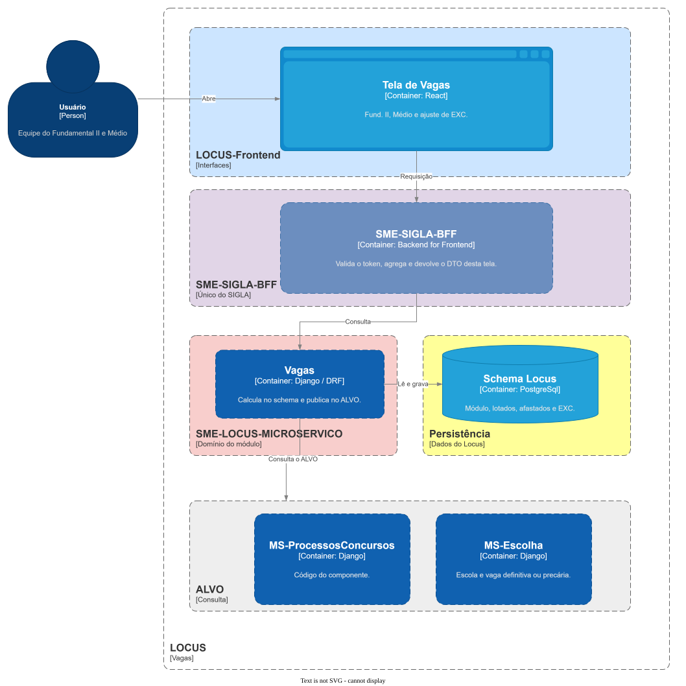
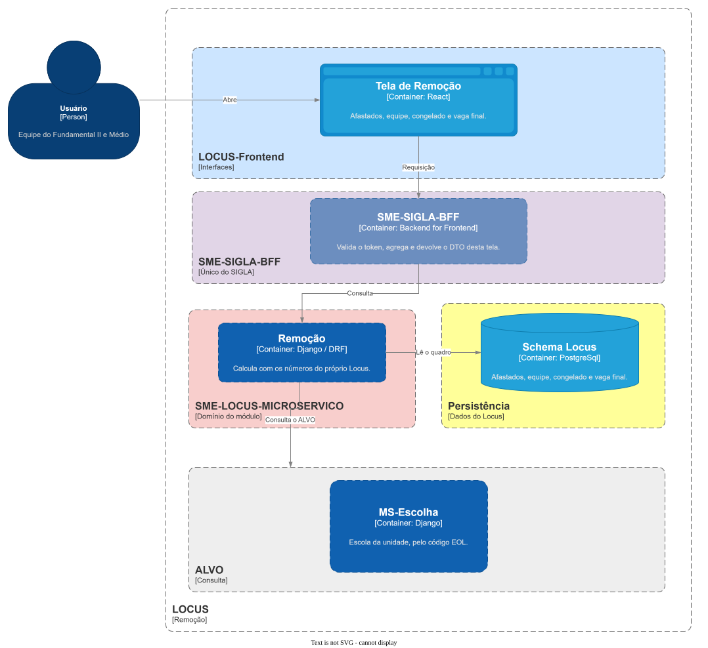

# Containers deste cenário

Diagramas de containers deste cenário. O front do ALVO e o front do Locus falam com um SME-SIGLA-BFF único. O SME-SIGLA-BFF valida o token, consulta os microsserviços, agrega os dados e devolve o DTO da tela. O SME-LOCUS-MICROSERVICO lê no ALVO o que o processo de concurso, convocação e escolha já gravou. O sistema executa a carga inicial do arquivo Access. O Airflow busca só o EOL, de tempos em tempos, e grava o resultado na base do Locus.

Estes desenhos estão em `diagramas/assets`, arquivos `17` a `23`. O código do ALVO ainda não tem o SME-SIGLA-BFF. Ele entra a partir desta arquitetura ([ADR-015](../../documentos/adr/ADR-015-bff-unico.md)).

## Visão geral

| De                             | Para                                                                                | O que passa                                                          |
| ------------------------------ | ----------------------------------------------------------------------------------- | -------------------------------------------------------------------- |
| Front do ALVO e Front do Locus | SME-SIGLA-BFF                                                                       | Requisição da tela. O SME-SIGLA-BFF valida o token                   |
| SME-SIGLA-BFF                  | MS-AdminUsuarios, SME-LOCUS-MICROSERVICO e microsserviços do ALVO                   | Consulta, agregação e DTO da tela                                    |
| SME-LOCUS-MICROSERVICO         | Schema do Locus                                                                     | Quadro que nenhum MS do ALVO guarda                                  |
| SME-LOCUS-MICROSERVICO         | MS-ProcessosConcursos, MS-Candidatos, MS-Agenda, MS-ProcessosConvocacao, MS-Escolha | Cargo, pessoa, nomeação, processo, escola e vaga já gravados no ALVO |
| Microsserviços do ALVO         | Base do ALVO                                                                        | Leitura e gravação dos schemas do ALVO                               |
| Banco Access                   | Schema do Locus                                                                     | Carga inicial executada pelo sistema. Uma vez                        |

O MS-ImportaArquivos continua sendo a porta de entrada do ALVO. O Locus não recebe lote dele.

## Importação periódica do EOL

O modo de importação roda no Airflow, no mesmo arranjo da visão de ETL: uma origem, o fluxo que busca, e a base que recebe o resultado. 

A origem é o EOL.  
O Airflow grava na base do Locus.  O
 gravado pode ser um arquivo JSON, um PDF ou um arquivo hash.

Para a parte de confronto de dados entre EOL  e o SIGLA de forma automática pode-se utilizar o msm esquema de geração de dados no fluxo 2 Relatório. 

| Passo    | O que o container faz                                       |
| -------- | ----------------------------------------------------------- |
| Agenda   | O Airflow dispara a execução                                |
| Busca    | O Airflow consulta só o EOL                                 |
| Gravação | O Airflow salva na base do Locus um JSON, um PDF ou um hash |

## Fluxo 1 — Cadastro

O formulário grava no schema do Locus. Unidade e cargo são lidos no ALVO. A pessoa só é lida no MS-Candidatos quando o RF existe lá. ATIVEOL não tem chamada: o ALVO não guarda o quadro funcional do EOL.

| Peça                                                                       | Origem neste cenário    |
| -------------------------------------------------------------------------- | ----------------------- |
| Local, tipo da unidade, sigla da DRE                                       | MS-Escolha              |
| Código e descrição do cargo                                                | MS-ProcessosConcursos   |
| Nome, CPF, vínculo e classificação de concursado                           | MS-Candidatos           |
| Cargo atual, atividade, afastamento, exercício, lotação, norteador, motivo | Schema do Locus         |
| ATIVEOL                                                                    | Sem fonte. Fica de fora |

## Fluxo 2 — Relatórios

Dois ritmos, pela demanda de processamento. 

O relatório de menor processamento volta na hora: a chamada é síncrona e a tela responde de forma dinâmica. 

O relatório de grande processamento é assíncrono: o Relatorio dispara uma DAG do Airflow e envia um job ao WORKER. A DAG grava o relatório na base do Locus. O WORKER lê e grava nessa mesma base. 

A tela de relatórios chama o SME-SIGLA-BFF. O SME-SIGLA-BFF valida o token. No caminho síncrono, devolve o relatório na hora. No caminho assíncrono, a mesma tela apresenta o relatório quando o Airflow termina de gravar.

| Peça               | Papel                                                                            |
| ------------------ | -------------------------------------------------------------------------------- |
| Schema do Locus    | Única base. O WORKER lê e grava nela. A DAG grava o relatório nela               |
| Relatorio          | Responde na hora o de menor processamento. Dispara a DAG e envia o job ao WORKER |
| WORKER             | Recebe o job. Lê e grava na base do Locus                                        |
| Airflow            | DAG do relatório pesado. Executa e grava o relatório na base do Locus            |
| SME-SIGLA-BFF      | Valida o token. Devolve o relatório leve na hora e o pesado quando a DAG termina |
| Tela de Relatórios | Mostra o síncrono na hora e o assíncrono quando o Airflow conclui                |
| Front Locus        | Redireciona para a tela de relatórios                                            |

| Ritmo      | Caminho                                                                                                                     |
| ---------- | --------------------------------------------------------------------------------------------------------------------------- |
| Síncrono   | Menor processamento. A tela recebe a resposta na hora                                                                       |
| Assíncrono | Grande processamento. O Relatorio dispara a DAG e envia o job. A DAG grava o relatório. A tela mostra quando estiver pronto |

## Fluxo 3 — Data base

Datas operacionais do módulo ficam no Locus. A migração não busca o Sistema Escolha: lê agenda, processo, habilitado e escolha que o ALVO já tem, e o usuário confirma a gravação do vínculo.

| Passo do levantamento               | Neste cenário                                                                                                                      |
| ----------------------------------- | ---------------------------------------------------------------------------------------------------------------------------------- |
| Data base EOL = ATIVEOL             | Sem data equivalente no ALVO. A tela mostra Data base DOC e, como referência de processo, `nomeacao_em` e `data_fechamento_modulo` |
| 1º passo da migração                | Consulta MS-Agenda, MS-ProcessosConvocacao, MS-Candidatos e MS-Escolha                                                             |
| 2º passo, Acrescenta migração       | Grava o vínculo novo no schema do Locus                                                                                            |
| Controle de atualizações e extratos | Leitura da auditoria e da movimentação do Locus                                                                                    |

## Fluxo 4 — Vagas

A tela pede o cálculo ao SME-SIGLA-BFF. O SME-SIGLA-BFF chama o SME-LOCUS-MICROSERVICO. O serviço lê, no schema do Locus, o módulo da unidade, os lotados e os afastados, e calcula a vaga.

| Opção da tela                             | Neste cenário                                                          |
| ----------------------------------------- | ---------------------------------------------------------------------- |
| Vagas Fund. II e Médio, Vagas Médio       | Calculadas no SME-LOCUS-MICROSERVICO com os números do schema do Locus |
| Ajuste de EXC                             | Gravado no schema do Locus. O cálculo é refeito                        |
| Confronto com o EOL                       | A tela usa o número do Locus                                           |
| Módulo, lotados, afastados e vagas do EOL | A tela mostra o que está gravado no Locus                              |

## Fluxo 5 — Remoção

Consultas, equipe, congelado e vaga final usam o schema do Locus e a escola do MS-Escolha. O confronto com o EOL não tem dado reaproveitável.

| Bloco                                                      | Neste cenário                                                                      |
| ---------------------------------------------------------- | ---------------------------------------------------------------------------------- |
| Confronto de módulos, lotados, afastados e vagas com o EOL | Fora                                                                               |
| Afastado perde lotação, outros afastamentos, liminar       | Leitura do schema do Locus                                                         |
| Equipe da unidade                                          | Vínculos do Locus na escola do MS-Escolha                                          |
| Congelado nosso                                            | Fotografia gravada no schema do Locus                                              |
| Congelado EOL                                              | Fora                                                                               |
| Vagas para remoção                                         | Cálculo no SME-LOCUS-MICROSERVICO a partir dos números conferidos no próprio Locus |
| Carga da remoção                                           | Continua a mapear no levantamento. Não há carga pronta em nenhum MS                |

## Resumo arquitetural

O navegador fala só com o SME-SIGLA-BFF. O SME-SIGLA-BFF valida o token, consulta os microsserviços e devolve um DTO da tela. O front do ALVO e o front do Locus usam esse mesmo SME-SIGLA-BFF. O login continua no MS-AdminUsuarios, chamado pelo SME-SIGLA-BFF.

O SME-LOCUS-MICROSERVICO guarda o quadro do módulo no schema do Locus: lotação, exercício, afastamento, módulo e vaga calculada. Concurso, convocação e escolha são lidos nos microsserviços do ALVO. O MS-ImportaArquivos segue como porta de entrada do ALVO.

Duas cargas entram nesse schema. O Access entra uma vez, na carga inicial. O Airflow, de tempos em tempos, busca só o EOL e grava na base do Locus um JSON, um PDF ou um hash.

As telas seguem esse desenho. O Cadastro grava o quadro e lê unidade, cargo e pessoa no ALVO. O relatório leve volta na hora; o pesado dispara uma DAG do Airflow e um job ao WORKER, e os dois gravam na mesma base. A Data base lê a nomeação que o ALVO já tem e confirma o vínculo no Locus. A vaga é calculada com módulo, lotados e afastados do schema do Locus. A Remoção lê o quadro do Locus e a escola no MS-Escolha. A carga da remoção continua a mapear.