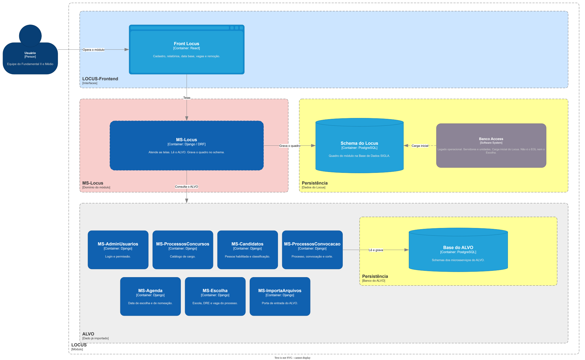
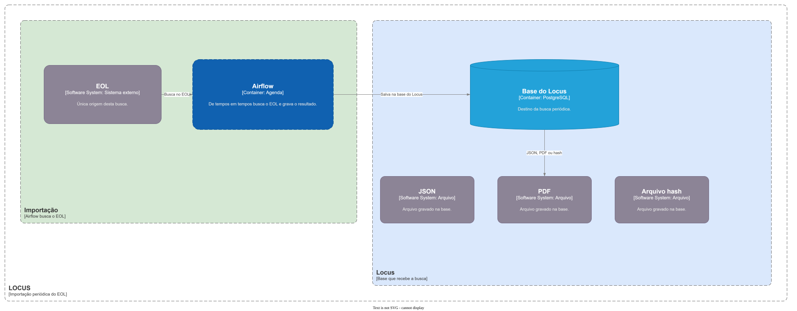
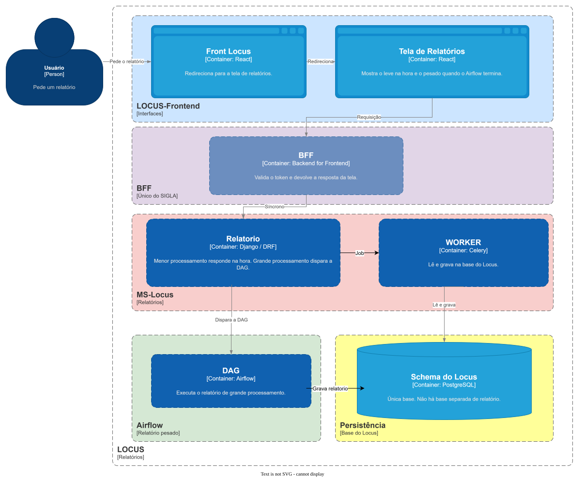
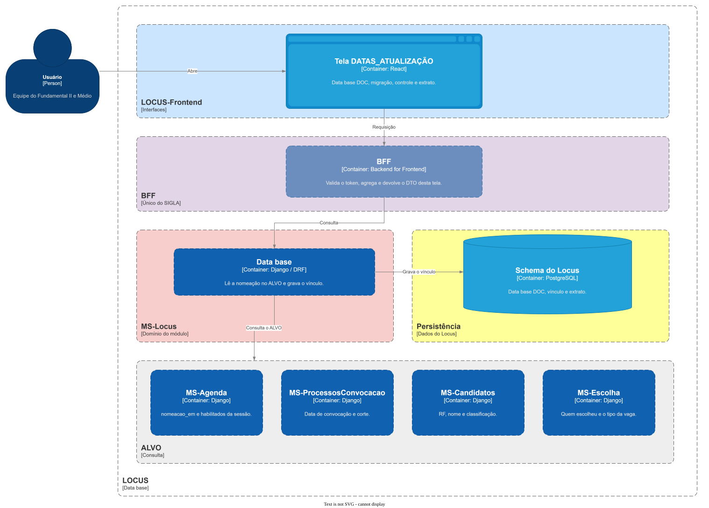
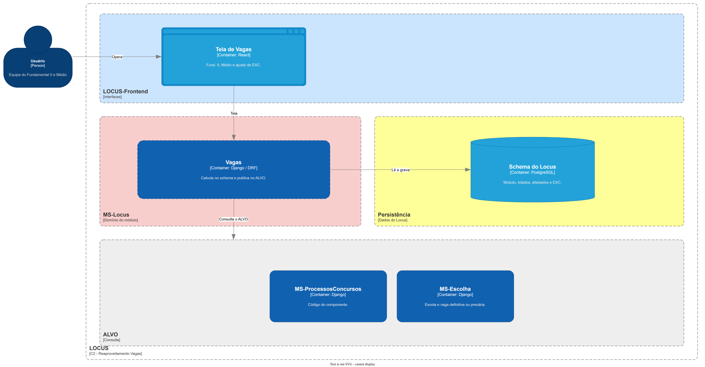
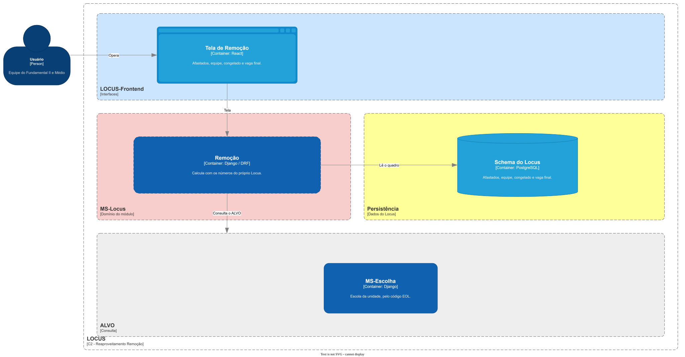

# Containers deste cenário

Diagramas de containers deste cenário. O front do ALVO e o front do Locus falam com um BFF único. O BFF valida o token, consulta os microsserviços, agrega os dados e devolve o DTO da tela. O MS-Locus lê no ALVO o que o processo de concurso, convocação e escolha já gravou. O sistema executa a carga inicial do arquivo Access. O Airflow busca só o EOL, de tempos em tempos, e grava o resultado na base do Locus.

Estes desenhos estão em `diagramas/assets`, arquivos `17` a `23`. O código do ALVO ainda não tem o BFF. Ele entra a partir desta arquitetura ([ADR-015](../../documentos/adr/ADR-015-bff-unico.md)).

## Visão geral

| De                             | Para                                                                                | O que passa                                                          |
| ------------------------------ | ----------------------------------------------------------------------------------- | -------------------------------------------------------------------- |
| Front do ALVO e Front do Locus | BFF                                                                                 | Requisição da tela. O BFF valida o token                             |
| BFF                            | MS-AdminUsuarios, MS-Locus e microsserviços do ALVO                                 | Consulta, agregação e DTO da tela                                    |
| MS-Locus                       | Schema do Locus                                                                     | Quadro que nenhum MS do ALVO guarda                                  |
| MS-Locus                       | MS-ProcessosConcursos, MS-Candidatos, MS-Agenda, MS-ProcessosConvocacao, MS-Escolha | Cargo, pessoa, nomeação, processo, escola e vaga já gravados no ALVO |
| Microsserviços do ALVO         | Base do ALVO                                                                        | Leitura e gravação dos schemas do ALVO                               |
| Banco Access                   | Schema do Locus                                                                     | Carga inicial executada pelo sistema. Uma vez                        |

O MS-ImportaArquivos continua sendo a porta de entrada do ALVO. O Locus não recebe lote dele.

## Importação periódica do EOL

O modo de importação roda no Airflow, no mesmo arranjo da visão de ETL: uma origem, o fluxo que busca, e a base que recebe o resultado. A origem é só o EOL. O Airflow grava na base do Locus. O gravado pode ser um arquivo JSON, um PDF ou um arquivo hash.

| Passo    | O que o container faz                                       |
| -------- | ----------------------------------------------------------- |
| Agenda   | O Airflow dispara a execução                                |
| Busca    | O Airflow consulta só o EOL                                 |
| Gravação | O Airflow salva na base do Locus um JSON, um PDF ou um hash |

## Fluxo 1 — Cadastro

O formulário grava no schema do Locus. Unidade e cargo são lidos no ALVO. A pessoa só é lida no MS-Candidatos quando o RF existe lá. ATIVEOL não tem chamada: o ALVO não guarda o quadro funcional do EOL.

| Peça                                                                       | Origem neste cenário    |
| -------------------------------------------------------------------------- | ----------------------- |
| Local, tipo da unidade, sigla da DRE                                       | MS-Escolha              |
| Código e descrição do cargo                                                | MS-ProcessosConcursos   |
| Nome, CPF, vínculo e classificação de concursado                           | MS-Candidatos           |
| Cargo atual, atividade, afastamento, exercício, lotação, norteador, motivo | Schema do Locus         |
| ATIVEOL                                                                    | Sem fonte. Fica de fora |

## Fluxo 2 — Relatórios

Dois ritmos, pela demanda de processamento. 

O relatório de menor processamento volta na hora: a chamada é síncrona e a tela responde de forma dinâmica. 

O relatório de grande processamento é assíncrono: o Relatorio dispara uma DAG do Airflow e envia um job ao WORKER. A DAG grava o relatório na base do Locus. O WORKER lê e grava nessa mesma base. 

A tela de relatórios chama o BFF. O BFF valida o token. No caminho síncrono, devolve o relatório na hora. No caminho assíncrono, a mesma tela apresenta o relatório quando o Airflow termina de gravar.

| Peça                | Papel                                                                                    |
| ------------------- | ---------------------------------------------------------------------------------------- |
| Schema do Locus     | Única base. O WORKER lê e grava nela. A DAG grava o relatório nela                       |
| Relatorio           | Responde na hora o de menor processamento. Dispara a DAG e envia o job ao WORKER         |
| WORKER              | Recebe o job. Lê e grava na base do Locus                                                |
| Airflow             | DAG do relatório pesado. Executa e grava o relatório na base do Locus                    |
| BFF                 | Valida o token. Devolve o relatório leve na hora e o pesado quando a DAG termina         |
| Tela de Relatórios  | Mostra o síncrono na hora e o assíncrono quando o Airflow conclui                        |
| Front Locus         | Redireciona para a tela de relatórios                                                    |

| Ritmo      | Caminho                                                                                            |
| ---------- | -------------------------------------------------------------------------------------------------- |
| Síncrono   | Menor processamento. A tela recebe a resposta na hora                                              |
| Assíncrono | Grande processamento. O Relatorio dispara a DAG e envia o job. A DAG grava o relatório. A tela mostra quando estiver pronto |

## Fluxo 3 — Data base

Datas operacionais do módulo ficam no Locus. A migração não busca o Sistema Escolha: lê agenda, processo, habilitado e escolha que o ALVO já tem, e o usuário confirma a gravação do vínculo.

| Passo do levantamento               | Neste cenário                                                                                                                      |
| ----------------------------------- | ---------------------------------------------------------------------------------------------------------------------------------- |
| Data base EOL = ATIVEOL             | Sem data equivalente no ALVO. A tela mostra Data base DOC e, como referência de processo, `nomeacao_em` e `data_fechamento_modulo` |
| 1º passo da migração                | Consulta MS-Agenda, MS-ProcessosConvocacao, MS-Candidatos e MS-Escolha                                                             |
| 2º passo, Acrescenta migração       | Grava o vínculo novo no schema do Locus                                                                                            |
| Controle de atualizações e extratos | Leitura da auditoria e da movimentação do Locus                                                                                    |

## Fluxo 4 — Vagas

O cálculo usa módulo, lotados e afastados do schema do Locus. A vaga calculada é publicada no MS-Escolha. O confronto com o EOL não tem de onde ler a tabela MOU.

A publicação preenche `vagas_definitivas` e `vagas_precarias` da escola e do cargo, com a data de fechamento do módulo. O MS-ImportaArquivos segue exportando esse registro no formato SIGPEC, como já faz para o ALVO. O Locus não gera o CSV nem fala com o SIGPEC.

| Opção da tela                             | Neste cenário                                                                  |
| ----------------------------------------- | ------------------------------------------------------------------------------ |
| Vagas Fund. II e Médio, Vagas Médio       | Calculadas no MS-Locus                                                         |
| Ajuste de EXC                             | Gravado no schema do Locus e recalculado                                       |
| Escolha                                   | Publicação no MS-Escolha. Os passos manuais de limpar coluna e enviar CSV saem |
| Confronto com EOL                         | Fora. Não há tabela MOU importada em nenhum MS                                 |
| Módulo, lotados, afastados e vagas do EOL | Fora. A tela pode mostrar os números do Locus                                  |

## Fluxo 5 — Remoção

Consultas, equipe, congelado e vaga final usam o schema do Locus e a escola do MS-Escolha. Confronto com EOL e planilha do CI não têm dado reaproveitável. Vaga precária do MS-Escolha é a oferta do processo, não a lista de professores precários do CI.

| Bloco                                                      | Neste cenário                                                        |
| ---------------------------------------------------------- | -------------------------------------------------------------------- |
| Confronto de módulos, lotados, afastados e vagas com o EOL | Fora                                                                 |
| Precários do CI                                            | Fora                                                                 |
| Afastado perde lotação, outros afastamentos, liminar       | Leitura do schema do Locus                                           |
| Equipe da unidade                                          | Vínculos do Locus na escola do MS-Escolha                            |
| Congelado nosso                                            | Fotografia gravada no schema do Locus                                |
| Congelado EOL                                              | Fora                                                                 |
| Vagas para remoção                                         | Cálculo no MS-Locus a partir dos números conferidos no próprio Locus |
| Carga da remoção                                           | Continua a mapear no levantamento. Não há carga pronta em nenhum MS  |

## O que cada container deixa de existir

Nas telas, esse componente não existe no MS-Locus. O lugar da leitura de concurso, convocação e escolha é o ALVO. A busca periódica no EOL fica no Airflow. O arquivo Access entra na carga inicial, executada pelo sistema.