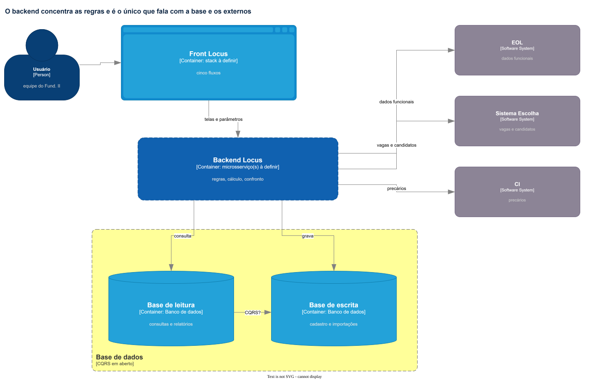
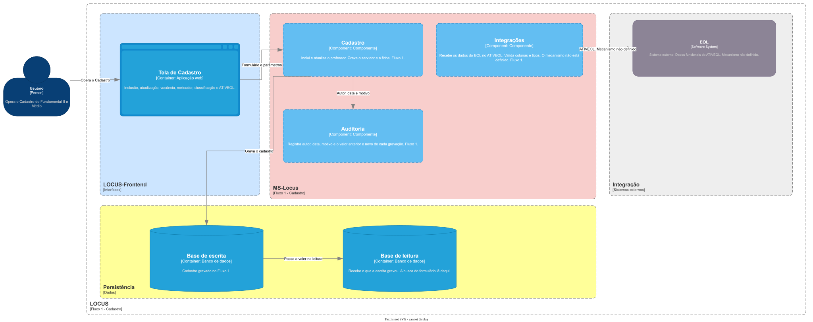
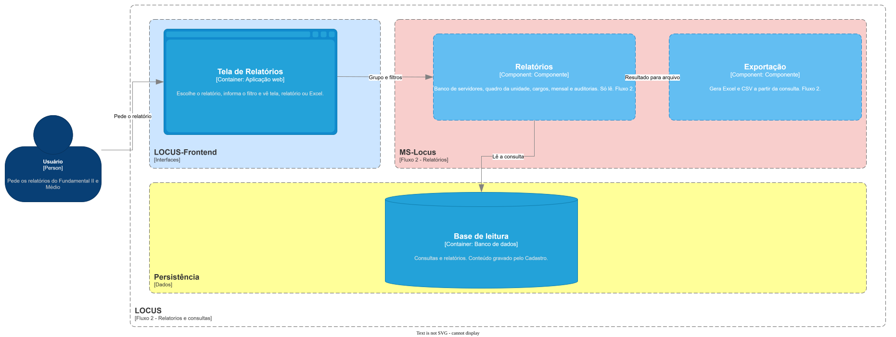
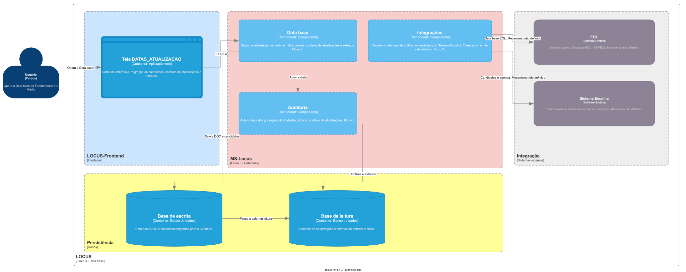
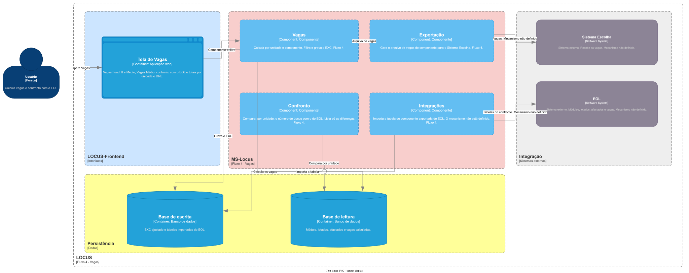
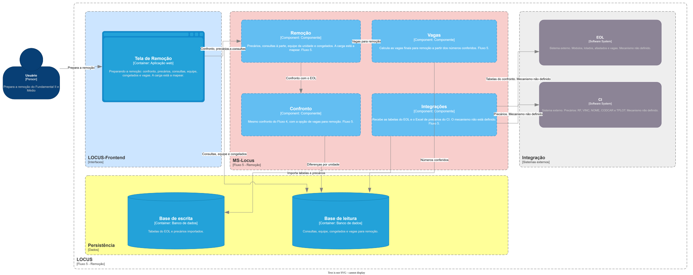

# Fundamental II e Médio

Recorte do levantamento de 05/11/2026. O texto está em [Fundamental II e Médio](../../visao-arquitetural/proposta-fundamental-ii-medio.md).

O usuário opera pelo front. O MS-Locus aplica a regra e acessa a base e o EOL. A forma dessa integração não está definida.

## Contexto — Fluxo 1 e Fluxo 2

## Containers — Cadastro

## Containers — Relatórios

## Containers — Data base

## Containers — Vagas

## Containers — Remoção

| Fluxo | Entrada | O que faz |
| --- | --- | --- |
| 1 Cadastro | Fundamental II > Cadastro | Inclui e atualiza o professor. Grava na base de escrita. Acessa o EOL no ATIVEOL |
| 2 Relatórios e consultas | Fundamental II > Relatórios / Consultas | Só lê a base de leitura. Não acessa sistema externo |
| 3 Data base | Fundamental II > Data base | Datas de referência, migração de candidatos, controle e extratos. Acessa EOL e Sistema Escolha |
| 4 Vagas | Fundamental II > Vagas | Calcula vagas, exporta ao Sistema Escolha e confronta com o EOL |
| 5 Remoção | Fundamental II > Remoção | Confronto, precários do CI, consultas, congelados e vagas para remoção. A carga está a mapear |
