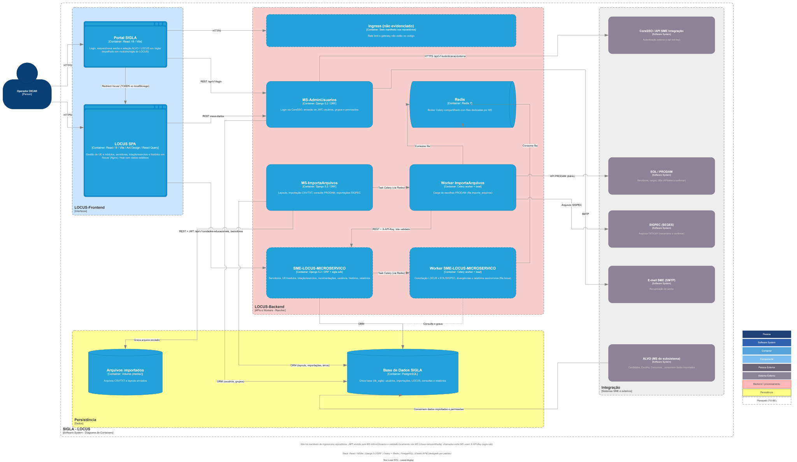

# Documentação Arquitetural — LOCUS (Lotação e Controle Unificado de Servidores)

**Sistema:** LOCUS (subsistema do SIGLA)  
**Data da análise:** Outubro/2026  
**Versão do documento:** 1.0  

## 1. Visão Geral do Sistema

O **SIGLA** é composto por dois subsistemas: **ALVO** (Alocação de Vagas Online — convocação e escolha de vagas) e **LOCUS** (gestão do quadro funcional e da lotação). Ambos compartilham o login (Portal SIGLA + API SME Integração) e a **Base de Dados SIGLA (BASE SIGLA)** — um único PostgreSQL (`db_sigla`). Os microsserviços existentes são Python/Django.

Em outubro/2026 o LOCUS tem **frontend em construção com dados estáticos**. **MS-AdminUsuarios** faz o login do SIGLA (grupos atuais do ALVO). **MS-ImportaArquivos** atende o ALVO (habilitados, escolhas PRODAM, exportação SIGPEC). Esta documentação propõe o **MS-Locus** para o domínio de servidores, unidades e lotação (ADR-004).

### 1.1 — Mapa de produtos e repositórios


| Componente             | Repositório                                                  | Tecnologia principal                                                                                 | Função no LOCUS                                                                                                                | Situação                                                  |
| ---------------------- | ------------------------------------------------------------ | ---------------------------------------------------------------------------------------------------- | ------------------------------------------------------------------------------------------------------------------------------ | --------------------------------------------------------- |
| **Portal SIGLA**       | `SME-SIGLA-Frontend` (espelhado em `modules/sigla` do LOCUS) | React 19 / Vite                                                                                      | Login, recuperação de senha, seleção ALVO / LOCUS                                                                              | Existente                                                 |
| **LOCUS Frontend**     | `SME-SIGLA-LOCUS-Frontend`                                   | React 19, Vite 7, TypeScript, Ant Design 5, React Query, Axios, Zod, styled-components; Nginx alpine | Telas de UE, servidor, atualizações, menus do domínio                                                                          | **Em construção**; contratos prontos, respostas estáticas |
| **MS-AdminUsuarios**   | `SME-SIGLA-MS-AdminUsuarios`                                 | Django 5.2, DRF (Django REST Framework) 3.15, SimpleJWT, `sigla-sdk`                                 | Login via CoreSSO, JWT (JSON Web Token), usuários, grupos, senha, e-mail                                                       | Existente; grupos orientados ao ALVO                      |
| **MS-ImportaArquivos** | `SME-SIGLA-MS-ImportaArquivos`                               | Django 5.2 / DRF + Celery 5.4 + Redis                                                                | Layout de arquivo, escolhas PRODAM, exportação SIGPEC                                                                          | Existente (uso ALVO). Reuso pelo LOCUS é proposta (ADR-005) |
| **MS-Locus**           | *a criar*                                                    | Django 5.2 / DRF + Celery + `sigla-sdk`                                                              | Servidores, UE, módulos, lotação/exercício, movimentações, vacância, histórico, conciliação, relatórios                        | **TO-BE**                                                 |
| **sigla-sdk**          | `SME-SIGLA-SDK-Microsservico` (tag `1.1.1`)                  | Python                                                                                               | `http_client`, `CorrelationIdMiddleware`, `AuditlogJWTMiddleware`, `ApiKeyAuthentication` (`X-API-Key`), `CustomJsonFormatter` | Existente                                                 |


---

## 2. Diagrama de Arquitetura (containers)



---

## 3. Visão Detalhada dos Padrões Arquiteturais

### 3.1 — Qual tipo de conexão?

Comunicação **síncrona HTTP/REST** (HTTPS) entre frontend e microsserviços e entre microsserviços; **assíncrona via Celery + Redis** para cargas, conciliação e relatórios.

#### Clientes → APIs


| Origem                              | Destino                                                                     | Protocolo                             |
| ----------------------------------- | --------------------------------------------------------------------------- | ------------------------------------- |
| Front do ALVO e Front do Locus      | BFF único                                                                   | HTTPS. O BFF valida o token           |
| BFF                                 | MS-AdminUsuarios, microsserviços do ALVO e MS-Locus                         | Consulta interna. Agrega e devolve o DTO da tela |
| Airflow                             | EOL e base do Locus                                                         | Busca periódica. Grava JSON, PDF ou hash |
| MS → MS                             | Microsserviço de destino                                                    | `X-API-Key`, na rede interna          |


#### APIs / Workers → dados e integrações


| Conexão                      | Driver / padrão                                                                                              |
| ---------------------------- | ------------------------------------------------------------------------------------------------------------ |
| Base de Dados SIGLA          | PostgreSQL único (`db_sigla`) — Django ORM (psycopg); consultas e gravações na mesma base                    |
| Redis                        | Broker Celery (filas dedicadas por MS, ex.: `importa_arquivos`; proposta `locus`)                            |
| CoreSSO / API SME Integração | `requests` — `POST /api/v1/autenticacao/externa` (header `x-api-eol-key`), `AutenticacaoSgp/*`               |
| PRODAM                       | `api_prodam` (timeout 300 s)                                                                                 |
| MS → MS                      | `sigla-sdk.http_client` + `X-API-Key`, timeout 30 s                                                          |


---

### 3.2 — Utiliza cache no sistema? Qual?

**Não há cache de aplicação** nos MS analisados; Redis é usado apenas como **broker Celery**.


| Camada                                | Mecanismo                          | Uso                                                               |
| ------------------------------------- | ---------------------------------- | ----------------------------------------------------------------- |
| LOCUS SPA                             | React Query (memória do navegador) | Cache de consultas por chave, invalidação após mutação            |
| LOCUS SPA                             | `localStorage`                     | `TOKEN` JWT e dados do usuário                                    |
| MS-AdminUsuarios / MS-ImportaArquivos | —                                  | Sem cache                                                         |
| MS-Locus (TO-BE)                      | **Base de Dados SIGLA**            | Consultas e relatórios na mesma base; cache Redis só se medição indicar (≤ 3 s) |


---

### 3.3 — Existe padrão de observabilidade?

O `sigla-sdk` padroniza log JSON e correlation id. O cliente **Elastic APM** está nas settings e fica desligado por padrão (`ELASTIC_APM_ENABLED`). Grafana não está nos repositórios.


| Capacidade                               | MS-AdminUsuarios                | MS-ImportaArquivos | MS-Locus (TO-BE)                      | Frontend    |
| ---------------------------------------- | ------------------------------- | ------------------ | ------------------------------------- | ----------- |
| Logs JSON estruturados                   | Sim (`CustomJsonFormatter`)     | Sim                | Obrigatório                           | Console     |
| Correlation id                           | Sim (`CorrelationIdMiddleware`) | Sim                | Obrigatório                           | Não propaga |
| APM (Application Performance Monitoring) | `elastic-apm`                   | `elastic-apm`      | Obrigatório                           | —           |
| Log de chamadas HTTP                     | —                               | `LogRequestHttp`   | Recomendado                           | —           |
| Auditoria de dados                       | `django-auditlog`               | `django-auditlog`  | `django-auditlog` + versões (ADR-008) | —           |
| Health checks / probes                   | Não evidenciado                 | Não evidenciado    | `/health/live`, `/health/ready`       | Nginx       |


---

### 3.4 — Utiliza padrões de projeto? Quais?


| Padrão                                                       | Onde                                                                                                                                    |
| ------------------------------------------------------------ | --------------------------------------------------------------------------------------------------------------------------------------- |
| Microsserviço por domínio                                    | AdminUsuarios e ImportaArquivos existem no SIGLA (uso do ALVO). MS-Locus é proposta                                                     |
| Camadas `api → serializers → services → repository → models` | MS SIGLA existentes; adotado no MS-Locus                                                                                                |
| Repository                                                   | `repository.py` nos MS                                                                                                                  |
| Base única                                                   | Base de Dados SIGLA (PostgreSQL, `db_sigla`): consultas e gravações no mesmo banco (ADR-006)                |


---

### 3.5 — Pontos de entrada têm padrão de segurança?


| Ponto              | Mecanismo                                                | Lacuna                                                          |
| ------------------ | -------------------------------------------------------- | --------------------------------------------------------------- |
| Portal → login     | CoreSSO via MS-AdminUsuarios → JWT                       | Sem MFA                                                         |
| LOCUS SPA          | Bearer do `localStorage`; 401 limpa sessão, 403 → `/403` | **Rotas LOCUS sem AuthGuard** (só `modules/sigla` tem)          |
| MS-AdminUsuarios   | Session, Token, JWT, ApiKey                              | `CORS_ALLOW_ALL_ORIGINS=True`; access token de **7 dias**       |
| MS-ImportaArquivos | JWT HS256 (24 h) + ApiKey                                | `CORS_ALLOW_ALL_ORIGINS=True`; chave JWT cai para `SECRET_KEY`  |
| MS → MS            | `X-API-Key` (`sigla-sdk`)                                | Rotação não documentada                                         |
| Borda HTTP         | Não há manifesto de Ingress nos repositórios             | Rate limiting e WAF não evidenciados                            |


Detalhes e plano em [Segurança](../seguranca/index.md).

---

### 3.6 — Utiliza mensageria?

**Sim, via Celery com Redis como broker** 


| Fila               | Produtor                  | Consumidor             | Uso                                                                                   |
| ------------------ | ------------------------- | ---------------------- | ------------------------------------------------------------------------------------- |
| `importa_arquivos` | MS-ImportaArquivos / beat | Worker ImportaArquivos | Importações (beat `enfileirar_importacoes_escolhas` a cada 1 min); timeouts 300/360 s |
| `locus` (TO-BE)    | MS-Locus / beat           | Worker MS-Locus        | Conciliação diária. Relatório pesado vai para uma DAG do Airflow (ADR-011)            |


---

### 3.7 — Padrão de branches (`test` / `homolog` / `master`)

Os repositórios LOCUS já usam `test` → `homolog` → `master`, Ver ADR-010.

---

### 3.8 — Infra Kubernetes e dados (síntese)


| Item         | Situação                                                                                      |
| ------------ | --------------------------------------------------------------------------------------------- |
| Orquestração | Rancher citado no README do MS-ProcessosConvocacao; sem manifesto Kubernetes nos repositórios do LOCUS |
| Borda HTTP   | Sem manifesto de Ingress. Rate limit e gateway não estão no código                            |
| CI/CD        | Sem Jenkinsfile nos repositórios do LOCUS                                                     |
| Banco        | PostgreSQL único — Base de Dados SIGLA (BASE SIGLA, `db_sigla`)                               |
| Arquivos     | `media/` local no pod do MS-ImportaArquivos — **precisa de PVC ou object storage**             |
| Imagens      | Python 3.12 (MS), `nginx:alpine` (front, `VITE_BASE_PATH=/locus/`)                             |
| Testes       | Relatório de cobertura sem mínimo obrigatório; frontend com Jest                               |


---

## 4. Fluxos principais

### 4.1 — Login e acesso ao LOCUS

```text
Usuário → Front do ALVO ou Front do Locus → BFF (valida o token)
        → MS-AdminUsuarios /login → CoreSSO (API SME Integração)
        → BFF consulta os microsserviços, agrega e devolve o DTO da tela
```

### 4.2 — Integração e conciliação diária (proposta)

Hoje o MS-ImportaArquivos importa escolhas da PRODAM para o MS-Escolha e exporta vagas e lotes no formato SIGPEC. O fluxo abaixo é proposta para o quadro do LOCUS. A ingestão de arquivo SIGPEC para esse quadro não existe.

```text
Beat (madrugada) → Worker ImportaArquivos → EOL/PRODAM → valida layout → MS-Locus /integracao (X-API-Key)
→ Worker MS-Locus (ConciliacaoService) → divergências + histórico → tela de divergências (DICAR)
```

A busca periódica do módulo no EOL segue outro caminho. O Airflow consulta só o EOL e grava o resultado na base do Locus, em arquivo JSON, PDF ou hash. O desenho está na [importação periódica](../cenarios/reaproveitamento-alvo/containers.md). O BFF não entra nesse fluxo.

### 4.3 — Atualização funcional com histórico

```text
Operador → DetalheServidor → POST atualização (motivo, portaria, data, documento)
→ MS-Locus valida (serializer) → LotacaoService/MovimentacaoService → Base de Dados SIGLA + auditlog/versão
```

### 4.4 — Relatório

O ritmo depende da demanda de processamento. O de menor processamento é síncrono: a tela recebe a resposta na hora. O de grande processamento é assíncrono: uma DAG do Airflow executa a operação e grava na base do Locus. Não há base separada de relatório. A tela apresenta esse resultado quando o Airflow termina.

```text
Menor processamento → BFF → MS-Locus lê a base do Locus → tela mostra na hora

Grande processamento → MS-Locus dispara a DAG do Airflow → grava na base do Locus
→ tela mostra quando estiver pronto
```

O desenho está no [fluxo 2 do cenário de reaproveitamento](../cenarios/reaproveitamento-alvo/containers.md). Detalhe da decisão no [ADR-011](../documentos/adr/ADR-011-relatorios-assincronos.md).

---

### 4.5 — Módulo Fundamental II e Médio

O primeiro módulo da área fica no MS-Locus. O recorte cobre os cinco fluxos: Cadastro, Relatórios, Data base, Vagas e Remoção.

A entrevista (`Levantamento/transcricaoreuniao.vtt`) fechou o Sistema Escolha. Ele é o legado do ALVO. O ALVO não importa dado dele e não devolve nada. O Locus também não chama esse legado: a ligação “vagas e candidatos” saiu dos diagramas de contexto, de Data base e de Vagas. O nomeado que a equipe lança hoje no Banco Access passa a ser lido nos microsserviços do ALVO. A carga inicial do Locus é o conteúdo atual do Access. A planilha citada na entrevista é a do EOL, subida manualmente no Access; não é arquivo do Escolha.

EOL e CI continuam sem contrato de integração do MS-Locus. Containers deste recorte: [reaproveitamento do ALVO](../cenarios/reaproveitamento-alvo/containers.md).

## 5. Avaliação consolidada


| Dimensão              | Situação                                          | Nota                                    |
| --------------------- | ------------------------------------------------- | --------------------------------------- |
| Padronização de stack | MS seguem o mesmo padrão Django/DRF + `sigla-sdk` | Boa                                     |
| Contratos de API      | Frontend já define contratos (Zod)                | Boa — falta OpenAPI do MS-Locus         |
| Backend de domínio    | Inexistente                                       | **Crítico** para o MVP                  |
| Integração EOL/SIGPEC | Mecanismo indefinido                              | **Crítico**                             |
| Segurança             | CORS aberto, rotas sem guarda, JWT longo          | **Alta prioridade**                     |
| Observabilidade       | APM + logs JSON + correlation id                  | Boa — faltam health checks e dashboards |
| Esteira               | Branches corretas; Jenkinsfile fora do repo       | Média                                   |


### Páginas do drawio


| Página                              | Conteúdo                     | SVG                                           |
| ----------------------------------- | ---------------------------- | --------------------------------------------- |
| C4                                  | Legenda                      | `01-c4-legenda.svg`                           |
| C1 - Contexto LOCUS                 | Contexto do sistema          | `02-locus-contexto.svg`                       |
| C2 - Containers LOCUS               | Containers                   | `03-locus-containers.svg`                     |
| C3 - Componentes LOCUS Frontend     | Componentes do frontend      | `04-locus-componente-frontend.svg`            |
| C3 - Componentes MS-Locus (TO-BE)   | Componentes do MS de domínio | `05-locus-componente-ms-locus.svg`            |
| C3 - Componentes MS-ImportaArquivos | Componentes (uso ALVO)       | `06-locus-componente-ms-importa-arquivos.svg` |
| C3 - Componentes MS-AdminUsuarios   | Componentes                  | `07-locus-componente-ms-admin-usuarios.svg`   |
| SISTEMA - Pipeline CI/CD            | Esteira                      | `09-locus-pipeline-cicd.svg`                  |
| SISTEMA - Matriz Risco de Segurança | Matriz de risco              | `10-locus-matriz-risco.svg`                   |
| C2 - Reaproveitamento               | Visão, cadastro, relatórios, data base, vagas, remoção e importação do EOL | `17` a `23` em `diagramas/assets` |


---

## 6. Pontos de falha e mitigação


| Ponto de falha                            | Efeito                         | Mitigação                                                                 |
| ----------------------------------------- | ------------------------------ | ------------------------------------------------------------------------- |
| CoreSSO / API SME Integração indisponível | Ninguém faz login              | Timeout curto + mensagem clara; sessão vigente continua                   |
| PRODAM/EOL fora na janela de carga        | Conciliação do dia não roda    | Retry com backoff; alerta; LOCUS segue com dados do dia anterior          |
| Layout de importação inválido             | Importação de escolhas rejeitada | Validação + `ImportacaoErro`                                            |
| Redis indisponível                        | Filas param                    | Probes; alertas; tarefas idempotentes                                     |
| Pod do MS-ImportaArquivos reinicia        | Perda de arquivos em `media/`  | PVC (PersistentVolumeClaim) ou object storage                             |
| Relatório pesado na mesma base           | Consulta disputa recurso com a operação | Job assíncrono, paginação e índices (ADR-011)                      |
| Chave JWT compartilhada vazada            | Token forjado em todos os MS   | Chave dedicada (`JWT_SIGNING_KEY`) e rotação                              |


---

## Referências

- Repositórios `SME-SIGLA-LOCUS-Frontend`, `SME-SIGLA-Frontend`, `SME-SIGLA-MS-AdminUsuarios`, `SME-SIGLA-MS-ImportaArquivos`, `SME-SIGLA-SDK-Microsservico`
- Questionário do PO (Product Owner) LOCUS

