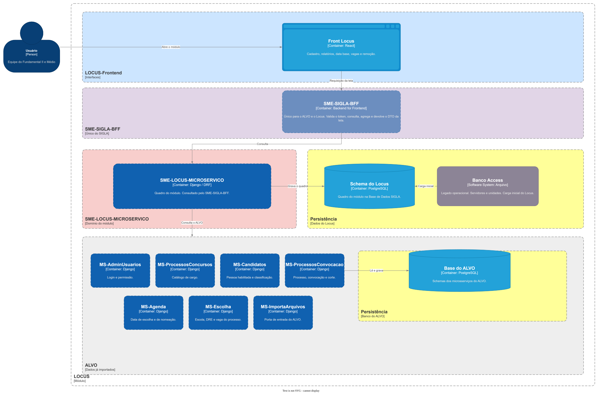

# Documentação Arquitetural — LOCUS (Lotação e Controle Unificado de Servidores)

**Sistema:** LOCUS (subsistema do SIGLA)  
**Data da análise:** Novembro/2026  
**Versão do documento:** 1.1  

## 1. Visão Geral do Sistema

O **SIGLA** é composto por dois subsistemas: **ALVO** (Alocação de Vagas Online — convocação e escolha de vagas) e **LOCUS** (gestão do quadro funcional e da lotação). Os dois compartilham o login (Portal SIGLA, MS-AdminUsuarios e API SME Integração, [ADR-002](../documentos/adr/ADR-002-autenticacao.md)) e, a partir desta arquitetura, um **SME-SIGLA-BFF** único ([ADR-015](../documentos/adr/ADR-015-bff-unico.md)).

As bases são separadas ([ADR-006](../documentos/adr/ADR-006-base-unica.md)). A **base do ALVO** guarda concurso, convocação, escolha e as importações que o ALVO já faz. A **base do Locus** guarda o quadro do módulo: lotação, exercício, afastamento, módulo e vaga calculada. O SME-LOCUS-MICROSERVICO lê e grava só a base do Locus. O que precisa do ALVO é lido por HTTP nos microsserviços do ALVO, com `X-API-Key`. Cada base tem credencial própria.

O navegador fala só com o SME-SIGLA-BFF. O SME-SIGLA-BFF valida o token, consulta os microsserviços, agrega os dados e devolve o DTO da tela. O código do ALVO ainda não tem esse componente. Ele entra a partir desta arquitetura.

Em outubro/2026 o LOCUS tem **frontend em construção com dados estáticos**. **MS-AdminUsuarios** faz o login do SIGLA. **MS-ImportaArquivos** é a porta de entrada das importações do ALVO (habilitados, escolhas PRODAM, exportação SIGPEC). O Locus recebe essas informações já gravadas, lendo os microsserviços do ALVO. A importação de arquivo do Locus segue outro caminho: a carga inicial copia o Banco Access uma vez; a busca periódica do EOL é uma DAG do Airflow, que grava JSON, PDF ou hash na base do Locus ([ADR-005](../documentos/adr/ADR-005-integracao-importa-arquivos.md)). O desenho está em [containers deste cenário](../cenarios/reaproveitamento-alvo/containers.md). Esta documentação propõe o **SME-LOCUS-MICROSERVICO** para o domínio de servidores, unidades e lotação ([ADR-004](../documentos/adr/ADR-004-ms-locus.md)).

### 1.1 — Mapa de produtos e repositórios

| Componente                 | Repositório                                                  | Tecnologia principal                                                                                 | Função no LOCUS                                                                                                                                                                                                                                           | Situação                                                                                  |
| -------------------------- | ------------------------------------------------------------ | ---------------------------------------------------------------------------------------------------- | --------------------------------------------------------------------------------------------------------------------------------------------------------------------------------------------------------------------------------------------------------- | ----------------------------------------------------------------------------------------- |
| **Portal SIGLA**           | `SME-SIGLA-Frontend` (espelhado em `modules/sigla` do LOCUS) | React 19 / Vite                                                                                      | Login, recuperação de senha, seleção ALVO / LOCUS                                                                                                                                                                                                         | Existente                                                                                 |
| **LOCUS Frontend**         | `SME-SIGLA-LOCUS-Frontend`                                   | React 19, Vite 7, TypeScript, Ant Design 5, React Query, Axios, Zod, styled-components; Nginx alpine | Telas de UE, servidor, atualizações, menus do domínio                                                                                                                                                                                                     | **Em construção**; contratos prontos, respostas estáticas                                 |
| **SME-SIGLA-BFF**          | *a criar*                                                    | A definir na implementação                                                                           | Valida o token, consulta os microsserviços, agrega e devolve o DTO da tela do ALVO e do Locus                                                                                                                                                             | **TO-BE**. O código do ALVO ainda não tem esse componente                                 |
| **MS-AdminUsuarios**       | `SME-SIGLA-MS-AdminUsuarios`                                 | Django 5.2, DRF (Django REST Framework) 3.15, SimpleJWT, `sigla-sdk`                                 | Login via CoreSSO, JWT (JSON Web Token), usuários, grupos, senha, e-mail. O SME-SIGLA-BFF fala com ele em nome da tela                                                                                                                                    | Existente; grupos orientados ao ALVO ([ADR-003](../documentos/adr/ADR-003-permissoes.md)) |
| **MS-ImportaArquivos**     | `SME-SIGLA-MS-ImportaArquivos`                               | Django 5.2 / DRF + Celery 5.4 + Redis                                                                | Porta de entrada das importações do ALVO. O Locus lê o resultado já gravado nos microsserviços do ALVO                                                                                                                                                    | Existente (uso ALVO)                                                                      |
| **Airflow**                | Plataforma de orquestração                                   | DAG                                                                                                  | Busca periódica só do EOL (grava JSON, PDF ou hash na base do Locus) e execução do relatório de grande processamento ([ADR-011](../documentos/adr/ADR-011-relatorios-assincronos.md))                                                                     | Definido neste desenho. Fora do SME-SIGLA-BFF e do MS-ImportaArquivos                     |
| **SME-LOCUS-MICROSERVICO** | *a criar*                                                    | Django 5.2 / DRF + Celery + `sigla-sdk`                                                              | Servidores, UE, módulos, lotação/exercício, movimentações, vacância, histórico ([ADR-008](../documentos/adr/ADR-008-historico-versoes.md)), confronto com o snapshot do EOL ([ADR-013](../documentos/adr/ADR-013-calculo-vagas-confronto.md)), relatórios | **TO-BE**                                                                                 |
| **Base do ALVO**           | PostgreSQL dos microsserviços do ALVO                        | PostgreSQL                                                                                           | Concurso, convocação, escolha e arquivos importados pelo ALVO                                                                                                                                                                                             | Existente                                                                                 |
| **Base do Locus**          | PostgreSQL do SME-LOCUS-MICROSERVICO                         | PostgreSQL                                                                                           | Quadro do módulo, carga inicial do Access, resultado do Airflow e relatórios                                                                                                                                                                              | **TO-BE**                                                                                 |
| **sigla-sdk**              | `SME-SIGLA-SDK-Microsservico` (tag `1.1.1`)                  | Python                                                                                               | `http_client`, `CorrelationIdMiddleware`, `AuditlogJWTMiddleware`, `ApiKeyAuthentication` (`X-API-Key`), `CustomJsonFormatter` ([ADR-001](../documentos/adr/ADR-001-backend-django.md))                                                                   | Existente                                                                                 |

---

## 2. Diagrama de Arquitetura (containers)

Visão vigente: front do ALVO e front do Locus no SME-SIGLA-BFF, SME-LOCUS-MICROSERVICO na base do Locus, microsserviços do ALVO na base do ALVO, carga inicial do Access e busca periódica do EOL pelo Airflow.

A importação periódica do EOL é uma DAG do Airflow. O Airflow consulta só o EOL e grava na base do Locus um JSON, um PDF ou um hash. O SME-SIGLA-BFF e o MS-ImportaArquivos ficam fora desse fluxo ([ADR-014](../documentos/adr/ADR-014-escolha-precarios.md)).

Os cinco fluxos do módulo (Cadastro, Relatórios, Data base, Vagas e Remoção, [ADR-012](../documentos/adr/ADR-012-modulo-fundamental-ii.md)) estão em [containers deste cenário](../cenarios/reaproveitamento-alvo/containers.md), diagramas `17` a `23`.

---

## 3. Visão Detalhada dos Padrões Arquiteturais

### 3.1 — Qual tipo de conexão?

Comunicação **síncrona HTTP/REST** (HTTPS) entre o navegador e o SME-SIGLA-BFF e entre o SME-SIGLA-BFF e os microsserviços. **Celery + Redis** permanece nas importações do ALVO e no worker do Locus ([ADR-007](../documentos/adr/ADR-007-assincrono-celery.md)). A busca periódica do EOL e o relatório de grande processamento rodam em **DAG do Airflow**.

#### Clientes → APIs

| Origem                         | Destino                                                                             | Protocolo                                                       |
| ------------------------------ | ----------------------------------------------------------------------------------- | --------------------------------------------------------------- |
| Front do ALVO e Front do Locus | SME-SIGLA-BFF único                                                                 | HTTPS. O SME-SIGLA-BFF valida o token                           |
| SME-SIGLA-BFF                  | MS-AdminUsuarios, microsserviços do ALVO e SME-LOCUS-MICROSERVICO                   | Consulta interna. Agrega e devolve o DTO da tela                |
| Airflow                        | EOL e base do Locus                                                                 | Busca periódica. Grava JSON, PDF ou hash. Fora do SME-SIGLA-BFF |
| SME-LOCUS-MICROSERVICO         | MS-ProcessosConcursos, MS-Candidatos, MS-Agenda, MS-ProcessosConvocacao, MS-Escolha | Leitura do que o ALVO já gravou. `X-API-Key`                    |
| MS-ImportaArquivos             | Microsserviços do ALVO e base do ALVO                                               | Importações já existentes do ALVO                               |
| MS → MS                        | Microsserviço de destino                                                            | `X-API-Key`, na rede interna                                    |

#### APIs / Workers → dados e integrações

| Conexão                      | Driver / padrão                                                                                  |
| ---------------------------- | ------------------------------------------------------------------------------------------------ |
| Base do ALVO                 | PostgreSQL dos microsserviços do ALVO. Credencial própria                                        |
| Base do Locus                | PostgreSQL do SME-LOCUS-MICROSERVICO. Credencial própria. Relatório leve e pesado usam esta base |
| Redis                        | Broker Celery. Fila `importa_arquivos` do ALVO. Fila `locus` do worker do Locus                  |
| CoreSSO / API SME Integração | `requests` — `POST /api/v1/autenticacao/externa` (header `x-api-eol-key`), `AutenticacaoSgp/*`   |
| PRODAM                       | `api_prodam` (timeout 300 s), no MS-ImportaArquivos, para o ALVO                                 |
| EOL                          | Consultado pela DAG do Airflow. O resultado fica na base do Locus                                |
| MS → MS                      | `sigla-sdk.http_client` + `X-API-Key`, timeout 30 s                                              |

---

### 3.2 — Utiliza cache no sistema? Qual?

**Não há cache de aplicação** nos MS analisados; Redis é usado apenas como **broker Celery**.

| Camada                                | Mecanismo                          | Uso                                                                          |
| ------------------------------------- | ---------------------------------- | ---------------------------------------------------------------------------- |
| LOCUS SPA                             | React Query (memória do navegador) | Cache de consultas por chave, invalidação após mutação                       |
| LOCUS SPA                             | `localStorage`                     | `TOKEN` JWT e dados do usuário                                               |
| MS-AdminUsuarios / MS-ImportaArquivos | —                                  | Sem cache                                                                    |
| SME-LOCUS-MICROSERVICO (TO-BE)        | **Base do Locus**                  | Consultas e relatórios nesta base. Cache Redis só se medição indicar (≤ 3 s) |

---

### 3.3 — Existe padrão de observabilidade?

O `sigla-sdk` padroniza log JSON e correlation id. O cliente **Elastic APM** está nas settings e fica desligado por padrão (`ELASTIC_APM_ENABLED`). Grafana não está nos repositórios ([ADR-009](../documentos/adr/ADR-009-infra-gateway.md)).

| Capacidade                               | MS-AdminUsuarios                | MS-ImportaArquivos | SME-LOCUS-MICROSERVICO (TO-BE)  | Frontend    |
| ---------------------------------------- | ------------------------------- | ------------------ | ------------------------------- | ----------- |
| Logs JSON estruturados                   | Sim (`CustomJsonFormatter`)     | Sim                | Obrigatório                     | Console     |
| Correlation id                           | Sim (`CorrelationIdMiddleware`) | Sim                | Obrigatório                     | Não propaga |
| APM (Application Performance Monitoring) | `elastic-apm`                   | `elastic-apm`      | Obrigatório                     | —           |
| Log de chamadas HTTP                     | —                               | `LogRequestHttp`   | Recomendado                     | —           |
| Auditoria de dados                       | `django-auditlog`               | `django-auditlog`  | `django-auditlog` + versões     | —           |
| Health checks / probes                   | Não evidenciado                 | Não evidenciado    | `/health/live`, `/health/ready` | Nginx       |

---

### 3.4 — Utiliza padrões de projeto? Quais?

| Padrão                                                       | Onde                                                                                                                                             |
| ------------------------------------------------------------ | ------------------------------------------------------------------------------------------------------------------------------------------------ |
| Microsserviço por domínio                                    | AdminUsuarios e ImportaArquivos existem no SIGLA e atendem o ALVO. SME-LOCUS-MICROSERVICO é proposta do quadro do módulo                         |
| SME-SIGLA-BFF único                                          | Um componente na frente do ALVO e do Locus. O navegador conhece esse endereço                                                                    |
| Camadas `api → serializers → services → repository → models` | MS SIGLA existentes; adotado no SME-LOCUS-MICROSERVICO                                                                                           |
| Repository                                                   | `repository.py` nos MS                                                                                                                           |
| Bases separadas                                              | Base do ALVO para os microsserviços do ALVO. Base do Locus para o quadro, a carga do Access, o Airflow e os relatórios. Leitura cruzada por HTTP |

---

### 3.5 — Pontos de entrada têm padrão de segurança?

| Ponto              | Mecanismo                                                                                       | Lacuna                                                         |
| ------------------ | ----------------------------------------------------------------------------------------------- | -------------------------------------------------------------- |
| Portal → login     | CoreSSO via MS-AdminUsuarios → JWT. O SME-SIGLA-BFF fala com o MS-AdminUsuarios em nome da tela | Sem MFA                                                        |
| Navegador → API    | Somente o SME-SIGLA-BFF. O BFF valida o token antes de consultar os microsserviços              | O código do ALVO ainda não tem o BFF                           |
| LOCUS SPA          | Bearer do `localStorage`; 401 limpa sessão, 403 → `/403`                                        | **Rotas LOCUS sem AuthGuard** (só `modules/sigla` tem)         |
| MS-AdminUsuarios   | Session, Token, JWT, ApiKey                                                                     | `CORS_ALLOW_ALL_ORIGINS=True`; access token de **7 dias**      |
| MS-ImportaArquivos | JWT HS256 (24 h) + ApiKey. Uso do ALVO                                                          | `CORS_ALLOW_ALL_ORIGINS=True`; chave JWT cai para `SECRET_KEY` |
| MS → MS            | `X-API-Key` (`sigla-sdk`)                                                                       | Rotação não documentada                                        |
| Borda HTTP         | Não há manifesto de Ingress nos repositórios                                                    | Rate limiting e WAF não evidenciados                           |

Detalhes e plano em [Segurança](../seguranca/index.md).

---

### 3.6 — Utiliza mensageria?

**Sim.** As importações do ALVO usam Celery com Redis. A importação periódica do EOL e o relatório de grande processamento usam DAG do Airflow.

| Fila ou agenda     | Produtor                                                                    | Consumidor                    | Uso                                                                                           |
| ------------------ | --------------------------------------------------------------------------- | ----------------------------- | --------------------------------------------------------------------------------------------- |
| `importa_arquivos` | MS-ImportaArquivos / beat                                                   | Worker ImportaArquivos        | Importações do ALVO (beat `enfileirar_importacoes_escolhas` a cada 1 min); timeouts 300/360 s |
| `locus` (TO-BE)    | SME-LOCUS-MICROSERVICO                                                      | Worker SME-LOCUS-MICROSERVICO | Job do relatório pesado. Lê e grava na base do Locus                                          |
| DAG do Airflow     | Agenda do Airflow, ou disparo do SME-LOCUS-MICROSERVICO no relatório pesado | Airflow                       | Busca periódica do EOL. Execução do relatório de grande processamento. Grava na base do Locus |

---

### 3.7 — Padrão de branches (`test` / `homolog` / `master`)

Os repositórios LOCUS já usam `test` → `homolog` → `master`. Ver [ADR-010](../documentos/adr/ADR-010-branches.md).

---

### 3.8 — Infra Kubernetes e dados (síntese)

| Item         | Situação                                                                                                                                                                    |
| ------------ | --------------------------------------------------------------------------------------------------------------------------------------------------------------------------- |
| Orquestração | Rancher citado no README do MS-ProcessosConvocacao; sem manifesto Kubernetes nos repositórios do LOCUS                                                                      |
| Borda HTTP   | Sem manifesto de Ingress. Rate limit e gateway não estão no código. O navegador chega ao SME-SIGLA-BFF                                                                      |
| CI/CD        | Sem Jenkinsfile nos repositórios do LOCUS                                                                                                                                   |
| Banco        | Bases separadas. Base do ALVO para os microsserviços do ALVO. Base do Locus para o SME-LOCUS-MICROSERVICO, a carga do Access, o Airflow e os relatórios                     |
| Arquivos     | Importação do ALVO: `media/` local no pod do MS-ImportaArquivos — **precisa de PVC ou object storage**. Importação do Locus: a DAG grava JSON, PDF ou hash na base do Locus |
| Imagens      | Python 3.12 (MS), `nginx:alpine` (front, `VITE_BASE_PATH=/locus/`)                                                                                                          |
| Testes       | Relatório de cobertura sem mínimo obrigatório; frontend com Jest                                                                                                            |

---

## 4. Fluxos principais

Os fluxos do sistema — login, importações, atualização do quadro, relatórios e o módulo Fundamental II e Médio (Cadastro, Relatórios, Data base, Vagas e Remoção) — estão descritos em [Containers deste cenário](../cenarios/reaproveitamento-alvo/containers.md).

## 5. Avaliação consolidada

| Dimensão              | Situação                                                                            | Nota                                                   |
| --------------------- | ----------------------------------------------------------------------------------- | ------------------------------------------------------ |
| Padronização de stack | MS seguem o mesmo padrão Django/DRF + `sigla-sdk`                                   | Boa                                                    |
| Contratos de API      | Frontend já define contratos (Zod). O DTO da tela fica no SME-SIGLA-BFF             | Boa — falta OpenAPI do SME-LOCUS-MICROSERVICO e do BFF |
| Backend de domínio    | Inexistente                                                                         | **Crítico** para o MVP                                 |
| Bases                 | Base do ALVO existente. Base do Locus a criar. Leitura cruzada por HTTP             | Definido                                               |
| Importação            | ALVO: MS-ImportaArquivos. Locus: carga única do Access e DAG do Airflow sobre o EOL | Definido no cenário de reaproveitamento                |
| Segurança             | CORS aberto, rotas sem guarda, JWT longo. BFF ainda ausente no código               | **Alta prioridade**                                    |
| Observabilidade       | APM + logs JSON + correlation id                                                    | Boa — faltam health checks e dashboards                |
| Esteira               | Branches corretas; Jenkinsfile fora do repo                                         | Média                                                  |

### Páginas do drawio

| Página                              | Conteúdo                                                             | SVG                                                                                                            |
| ----------------------------------- | -------------------------------------------------------------------- | -------------------------------------------------------------------------------------------------------------- |
| C4                                  | Legenda                                                              | [01-c4-legenda.svg](../diagramas/assets/01-c4-legenda.svg)                                                     |
| C1 - Contexto LOCUS                 | Contexto do sistema                                                  | [02-locus-contexto.svg](../diagramas/assets/02-locus-contexto.svg)                                             |
| C3 - Componentes MS-ImportaArquivos | Componentes da porta de entrada do ALVO                              | [06-locus-componente-ms-importa-arquivos.svg](../diagramas/assets/06-locus-componente-ms-importa-arquivos.svg) |
| C3 - Componentes MS-AdminUsuarios   | Componentes de identidade e permissões                               | [07-locus-componente-ms-admin-usuarios.svg](../diagramas/assets/07-locus-componente-ms-admin-usuarios.svg)     |
| SISTEMA - Pipeline CI/CD            | Esteira                                                              | [09-locus-pipeline-cicd.svg](../diagramas/assets/09-locus-pipeline-cicd.svg)                                   |
| SISTEMA - Matriz Risco de Segurança | Matriz de risco                                                      | [10-locus-matriz-risco.svg](../diagramas/assets/10-locus-matriz-risco.svg)                                     |
| C2 - Visão geral                    | Front, SME-SIGLA-BFF, SME-LOCUS-MICROSERVICO, bases separadas e ALVO | [17-reaproveitamento-visao-sigla.svg](../diagramas/assets/17-reaproveitamento-visao-sigla.svg)                 |
| C2 - Cadastro                       | Containers do cadastro                                               | [18-reaproveitamento-cadastro-sigla.svg](../diagramas/assets/18-reaproveitamento-cadastro-sigla.svg)           |
| C2 - Relatórios                     | Relatório na hora e relatório em DAG do Airflow                      | [19-reaproveitamento-relatorios-sigla.svg](../diagramas/assets/19-reaproveitamento-relatorios-sigla.svg)       |
| C2 - Data base                      | Nomeação lida no ALVO                                                | [20-reaproveitamento-database-sigla.svg](../diagramas/assets/20-reaproveitamento-database-sigla.svg)           |
| C2 - Vagas                          | Vaga calculada publicada no ALVO                                     | [21-reaproveitamento-vagas-sigla.svg](../diagramas/assets/21-reaproveitamento-vagas-sigla.svg)                 |
| C2 - Remoção                        | Equipe na escola do ALVO                                             | [22-reaproveitamento-remocao-sigla.svg](../diagramas/assets/22-reaproveitamento-remocao-sigla.svg)             |
| C2 - Importação EOL                 | Airflow busca o EOL e grava na base do Locus                         | [23-reaproveitamento-importacao-eol.svg](../diagramas/assets/23-reaproveitamento-importacao-eol.svg)           |
| C2 - Contexto Lotação               | Tela, SME-SIGLA-BFF, quadro na base do Locus e leitura no ALVO       | [24-locus-contexto-lotacao.svg](../diagramas/assets/24-locus-contexto-lotacao.svg)                             |

---

## 6. Pontos de falha e mitigação

| Ponto de falha                            | Efeito                                            | Mitigação                                                                                      |
| ----------------------------------------- | ------------------------------------------------- | ---------------------------------------------------------------------------------------------- |
| CoreSSO / API SME Integração indisponível | Ninguém faz login                                 | Timeout curto + mensagem clara; sessão vigente continua                                        |
| EOL fora na janela da DAG                 | A busca periódica do dia não grava novo snapshot  | Retry com backoff; alerta; a base do Locus segue com o snapshot anterior                       |
| PRODAM fora na janela do ALVO             | A importação de escolhas do ALVO não roda         | Retry do worker do MS-ImportaArquivos; o Locus continua lendo o que o ALVO já gravou           |
| Layout de importação do ALVO inválido     | Importação de escolhas rejeitada na base do ALVO  | Validação + `ImportacaoErro` no MS-ImportaArquivos                                             |
| Redis indisponível                        | Filas do ALVO e o job do worker do Locus param    | Probes; alertas; tarefas idempotentes. A DAG do Airflow segue o agendamento próprio            |
| Pod do MS-ImportaArquivos reinicia        | Perda de arquivos do ALVO em `media/`             | PVC (PersistentVolumeClaim) ou object storage                                                  |
| Relatório pesado na base do Locus         | Consulta disputa recurso com a operação do quadro | DAG do Airflow, job no worker, paginação e índices                                             |
| Chave JWT compartilhada vazada            | Token forjado em todos os MS                      | Chave dedicada (`JWT_SIGNING_KEY`) e rotação. O SME-SIGLA-BFF valida o token antes da consulta |

---

## Referências

- Repositórios `SME-SIGLA-LOCUS-Frontend`, `SME-SIGLA-Frontend`, `SME-SIGLA-MS-AdminUsuarios`, `SME-SIGLA-MS-ImportaArquivos`, `SME-SIGLA-SDK-Microsservico`
- [Containers do reaproveitamento](../cenarios/reaproveitamento-alvo/containers.md) e [base do Locus](../cenarios/reaproveitamento-alvo/base-de-dados.md)
- `Levantamento/transcricaoreuniao.vtt`
- [ADRs do LOCUS](../documentos/adr/index.md)
- Questionário do PO (Product Owner) LOCUS

