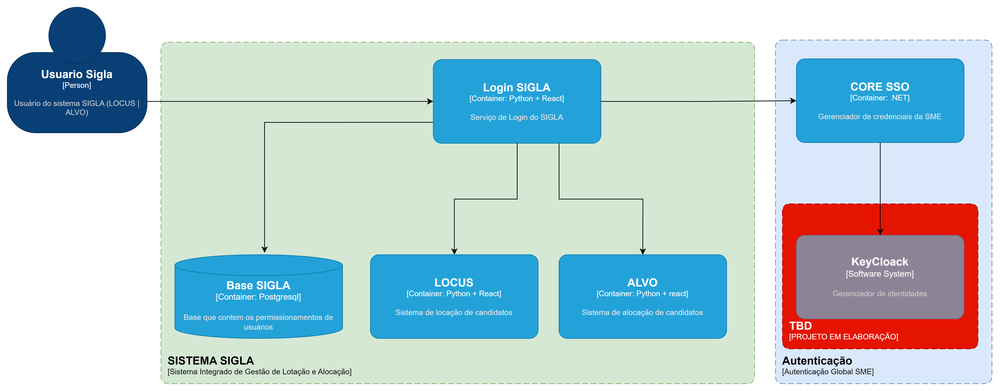
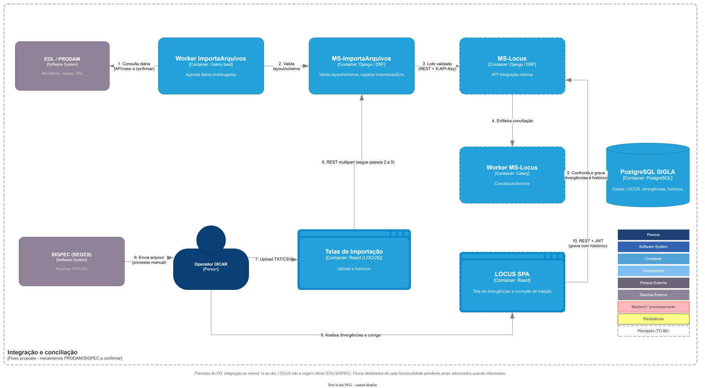

# Documentação Arquitetural — LOCUS (Lotação e Controle Unificado de Servidores)

**Sistema:** LOCUS (subsistema do SIGLA)  
**Data da análise:** Outubro/2026  
**Versão do documento:** 1.0  

## 1. Visão Geral do Sistema

O **SIGLA** é composto por dois subsistemas: **ALVO** (Alocação de Vagas Online — convocação e escolha de vagas) e **LOCUS** (gestão do quadro funcional, lotação, importação de dados e permissões). Ambos compartilham login (Portal SIGLA + CoreSSO), a **Base de Dados SIGLA (BASE SIGLA)** — **Base Sigla Escrita** e **Base Sigla Leitura**, em PostgreSQL com CQRS — e o padrão de microsserviços Python/Django em Kubernetes (Rancher).

Em outubro/2026 o LOCUS tem **frontend em construção com dados estáticos**. O LOCUS já conta com dois microsserviços — **MS-ImportaArquivos** e **MS-AdminUsuarios** — e esta documentação propõe um terceiro, o **MS-Locus**, para o domínio de servidores, unidades e lotação (ADR-004).

### 1.1 — Mapa de produtos e repositórios


| Componente             | Repositório                                                  | Tecnologia principal                                                                                 | Função no LOCUS                                                                                                                | Situação                                                  |
| ---------------------- | ------------------------------------------------------------ | ---------------------------------------------------------------------------------------------------- | ------------------------------------------------------------------------------------------------------------------------------ | --------------------------------------------------------- |
| **Portal SIGLA**       | `SME-SIGLA-Frontend` (espelhado em `modules/sigla` do LOCUS) | React 19 / Vite                                                                                      | Login, recuperação de senha, seleção ALVO / LOCUS                                                                              | Existente                                                 |
| **LOCUS Frontend**     | `SME-SIGLA-LOCUS-Frontend`                                   | React 19, Vite 7, TypeScript, Ant Design 5, React Query, Axios, Zod, styled-components; Nginx alpine | Telas de UE, servidor, atualizações, menus do domínio                                                                          | **Em construção**; contratos prontos, respostas estáticas |
| **MS-AdminUsuarios**   | `SME-SIGLA-MS-AdminUsuarios`                                 | Django 5.2, DRF (Django REST Framework) 3.15, SimpleJWT, `sigla-sdk`                                 | Login via CoreSSO, JWT (JSON Web Token), usuários, grupos, senha, e-mail                                                       | Existente; grupos orientados ao ALVO                      |
| **MS-ImportaArquivos** | `SME-SIGLA-MS-ImportaArquivos`                               | Django 5.2 / DRF + Celery 5.4 + Redis                                                                | Layouts, importação CSV/TXT, PRODAM, exportações SIGPEC                                                                        | Existente (uso ALVO); **reaproveitado** (ADR-005)         |
| **MS-Locus**           | *a criar*                                                    | Django 5.2 / DRF + Celery + `sigla-sdk`                                                              | Servidores, UE, módulos, lotação/exercício, movimentações, vacância, histórico, conciliação, relatórios                        | **TO-BE**                                                 |
| **sigla-sdk**          | `SME-SIGLA-SDK-Microsservico` (tag `1.1.1`)                  | Python                                                                                               | `http_client`, `CorrelationIdMiddleware`, `AuditlogJWTMiddleware`, `ApiKeyAuthentication` (`X-API-Key`), `CustomJsonFormatter` | Existente                                                 |


---

## 2. Diagrama de Arquitetura (containers)


---

## 3. Visão Detalhada dos Padrões Arquiteturais

### 3.1 — Qual tipo de conexão?

Comunicação **síncrona HTTP/REST** (HTTPS) entre frontend e microsserviços e entre microsserviços; **assíncrona via Celery + Redis** para cargas, conciliação e relatórios.

#### Clientes → APIs


| Origem                              | Destino                                                                     | Protocolo                             |
| ----------------------------------- | --------------------------------------------------------------------------- | ------------------------------------- |
| Portal SIGLA                        | MS-AdminUsuarios `/api/v1/login`, `esqueci-minha-senha`, `criar-nova-senha` | HTTPS + JSON                          |
| LOCUS SPA (Single Page Application) | MS-AdminUsuarios `/meus-dados`, permissões                                  | HTTPS + `Authorization: Bearer <JWT>` |
| LOCUS SPA                           | MS-Locus `/api/v1/unidades-educacionais/*`, `/api/v1/servidores/*` (TO-BE)  | HTTPS + JWT                           |
| Telas de importação (TO-BE)         | MS-ImportaArquivos (layouts, importações)                                   | HTTPS multipart + JWT                 |
| Todos                               | Ingress Nginx `api-sigla.sme.prefeitura.sp.gov.br/ms-*`                     | Roteamento por path                   |


#### APIs / Workers → dados e integrações


| Conexão                      | Driver / padrão                                                                                              |
| ---------------------------- | ------------------------------------------------------------------------------------------------------------ |
| Base Sigla Escrita           | PostgreSQL — Django ORM (psycopg); write model por domínio                                                   |
| Base Sigla Leitura           | PostgreSQL — read model (CQRS (Command Query Responsibility Segregation)); projeção do domínio LOCUS é TO-BE |
| Redis                        | Broker Celery (filas dedicadas por MS, ex.: `importa_arquivos`; proposta `locus`)                            |
| CoreSSO / API SME Integração | `requests` — `POST /api/v1/autenticacao/externa` (header `x-api-eol-key`), `AutenticacaoSgp/*`               |
| PRODAM                       | `api_prodam` (timeout 300 s)                                                                                 |
| MS → MS                      | `sigla-sdk.http_client` + `X-API-Key`, timeout 30 s                                                          |


---

### 3.2 — Utiliza cache no sistema? Qual?

**Não há cache de aplicação** nos MS analisados; Redis é usado apenas como **broker Celery**.


| Camada                                | Mecanismo                          | Uso                                                               |
| ------------------------------------- | ---------------------------------- | ----------------------------------------------------------------- |
| LOCUS SPA                             | React Query (memória do navegador) | Cache de consultas por chave, invalidação após mutação            |
| LOCUS SPA                             | `localStorage`                     | `TOKEN` JWT e dados do usuário                                    |
| MS-AdminUsuarios / MS-ImportaArquivos | —                                  | Sem cache                                                         |
| MS-Locus (TO-BE)                      | **Base Sigla Leitura**             | Consultas e relatórios; cache Redis só se medição indicar (≤ 3 s) |


---

### 3.3 — Existe padrão de observabilidade?

**Sim, padronizado pelo** `sigla-sdk` (Grafana + Elastic).


| Capacidade                               | MS-AdminUsuarios                | MS-ImportaArquivos | MS-Locus (TO-BE)                      | Frontend    |
| ---------------------------------------- | ------------------------------- | ------------------ | ------------------------------------- | ----------- |
| Logs JSON estruturados                   | Sim (`CustomJsonFormatter`)     | Sim                | Obrigatório                           | Console     |
| Correlation id                           | Sim (`CorrelationIdMiddleware`) | Sim                | Obrigatório                           | Não propaga |
| APM (Application Performance Monitoring) | `elastic-apm`                   | `elastic-apm`      | Obrigatório                           | —           |
| Log de chamadas HTTP                     | —                               | `LogRequestHttp`   | Recomendado                           | —           |
| Auditoria de dados                       | `django-auditlog`               | `django-auditlog`  | `django-auditlog` + versões (ADR-008) | —           |
| Health checks / probes                   | Não evidenciado                 | Não evidenciado    | `/health/live`, `/health/ready`       | Nginx       |


---

### 3.4 — Utiliza padrões de projeto? Quais?


| Padrão                                                       | Onde                                                                                                                                    |
| ------------------------------------------------------------ | --------------------------------------------------------------------------------------------------------------------------------------- |
| Microsserviço por domínio                                    | SIGLA — LOCUS: AdminUsuarios, ImportaArquivos, MS-Locus                                                                                 |
| Camadas `api → serializers → services → repository → models` | MS SIGLA existentes; adotado no MS-Locus                                                                                                |
| Repository                                                   | `repository.py` nos MS                                                                                                                  |
| CQRS                                                         | Base de Dados SIGLA: **Base Sigla Escrita** (write models por domínio) e **Base Sigla Leitura** (read models por processos assíncronos) |


---

### 3.5 — Pontos de entrada têm padrão de segurança?


| Ponto              | Mecanismo                                                | Lacuna                                                          |
| ------------------ | -------------------------------------------------------- | --------------------------------------------------------------- |
| Portal → login     | CoreSSO via MS-AdminUsuarios → JWT                       | Sem MFA                                                         |
| LOCUS SPA          | Bearer do `localStorage`; 401 limpa sessão, 403 → `/403` | **Rotas LOCUS sem AuthGuard** (só `modules/sigla` tem)          |
| MS-AdminUsuarios   | Session, Token, JWT, ApiKey                              | `CORS_ALLOW_ALL_ORIGINS=True`; access token de **7 dias**       |
| MS-ImportaArquivos | JWT HS256 (24 h) + ApiKey                                | `CORS_ALLOW_ALL_ORIGINS=True`; chave JWT cai para `SECRET_KEY`  |
| MS → MS            | `X-API-Key` (`sigla-sdk`)                                | Rotação não documentada                                         |
| Ingress            | TLS                                                      | Rate limiting / WAF (Web Application Firewall) não evidenciados |


Detalhes e plano em [Segurança](../seguranca/index.md).

---

### 3.6 — Utiliza mensageria?

**Sim, via Celery com Redis como broker** 


| Fila               | Produtor                  | Consumidor             | Uso                                                                                   |
| ------------------ | ------------------------- | ---------------------- | ------------------------------------------------------------------------------------- |
| `importa_arquivos` | MS-ImportaArquivos / beat | Worker ImportaArquivos | Importações (beat `enfileirar_importacoes_escolhas` a cada 1 min); timeouts 300/360 s |
| `locus` (TO-BE)    | MS-Locus / beat           | Worker MS-Locus        | Conciliação diária, relatórios assíncronos, projeção do read model                    |


---

### 3.7 — Padrão de branches (`test` / `homolog` / `master`)

Os repositórios LOCUS já usam `test` → `homolog` → `master`, Ver ADR-010.

---

### 3.8 — Infra Kubernetes e dados (síntese)


| Item         | Situação                                                                                      |
| ------------ | --------------------------------------------------------------------------------------------- |
| Orquestração | Kubernetes via Rancher — **a confirmar** para o LOCUS                                         |
| API Gateway  | Ingress Nginx; Keycloak, TLS, rate limiting previstos                                         |
| CI/CD        | Jenkins (Jenkinsfile mantido pela Infra Ágil, fora dos repositórios) + Registry SME           |
| Banco        | PostgreSQL — Base de Dados SIGLA (BASE SIGLA): Base Sigla Escrita e Base Sigla Leitura (CQRS) |
| Arquivos     | `media/` local no pod do MS-ImportaArquivos — **precisa de PVC ou object storage**            |
| Imagens      | Python 3.12 (MS), `nginx:alpine` (front, `VITE_BASE_PATH=/locus/`)                            |
| Testes       | Cobertura mínima de **80%**; frontend com Jest                                                |


---

## 4. Fluxos principais

### 4.1 — Login e acesso ao LOCUS

```text
Usuário → Portal SIGLA → MS-AdminUsuarios /login → CoreSSO (API SME Integração)
       ← JWT (localStorage TOKEN) → seleção de sistema → /locus/ → APIs com Bearer
```



### 4.2 — Integração e conciliação diária (proposta)

```text
Beat (madrugada) → Worker ImportaArquivos → EOL/PRODAM → valida layout → MS-Locus /integracao (X-API-Key)
→ Worker MS-Locus (ConciliacaoService) → divergências + histórico → tela de divergências (DICAR)
SIGPEC → arquivo → upload pelo operador → mesmo caminho a partir da validação
```



Detalhe em [Integrações EOL / SIGPEC](integracoes_eol_sigpec.md).

### 4.3 — Atualização funcional com histórico

```text
Operador → DetalheServidor → POST atualização (motivo, portaria, data, documento)
→ MS-Locus valida (serializer) → LotacaoService/MovimentacaoService → write model + auditlog/versão
→ projeção assíncrona no read model
```

### 4.4 — Relatório pesado

```text
Operador solicita → MS-Locus cria job (202 Accepted) → Worker gera arquivo a partir do read model
→ tela consulta status → download
```

---

### 4.5 — Módulo Fundamental II e Médio

O primeiro módulo da área fica no MS-Locus. O recorte cobre os cinco fluxos: Cadastro, Relatórios, Data base, Vagas e Remoção. A integração com EOL, Sistema Escolha e CI não está definida; o acesso é do MS-Locus. Texto e diagramas: [Fundamental II e Médio](proposta-fundamental-ii-medio.md).

## 5. Avaliação consolidada


| Dimensão              | Situação                                          | Nota                                    |
| --------------------- | ------------------------------------------------- | --------------------------------------- |
| Padronização de stack | MS seguem o mesmo padrão Django/DRF + `sigla-sdk` | Boa                                     |
| Contratos de API      | Frontend já define contratos (Zod)                | Boa — falta OpenAPI do MS-Locus         |
| Backend de domínio    | Inexistente                                       | **Crítico** para o MVP                  |
| Integração EOL/SIGPEC | Mecanismo indefinido                              | **Crítico**                             |
| Segurança             | CORS aberto, rotas sem guarda, JWT longo          | **Alta prioridade**                     |
| Observabilidade       | APM + logs JSON + correlation id                  | Boa — faltam health checks e dashboards |
| Esteira               | Branches corretas; Jenkinsfile fora do repo       | Média                                   |


### Páginas do drawio


| Página                              | Conteúdo                     | SVG                                           |
| ----------------------------------- | ---------------------------- | --------------------------------------------- |
| C4                                  | Legenda                      | `01-c4-legenda.svg`                           |
| C1 - Contexto LOCUS                 | Contexto do sistema          | `02-locus-contexto.svg`                       |
| C2 - Containers LOCUS               | Containers                   | `03-locus-containers.svg`                     |
| C3 - Componentes LOCUS Frontend     | Componentes do frontend      | `04-locus-componente-frontend.svg`            |
| C3 - Componentes MS-Locus (TO-BE)   | Componentes do MS de domínio | `05-locus-componente-ms-locus.svg`            |
| C3 - Componentes MS-ImportaArquivos | Componentes (uso LOCUS)      | `06-locus-componente-ms-importa-arquivos.svg` |
| C3 - Componentes MS-AdminUsuarios   | Componentes                  | `07-locus-componente-ms-admin-usuarios.svg`   |
| FLUXO - Integração e conciliação    | Fluxo EOL/SIGPEC proposto    | `08-locus-fluxo-integracao-eol-sigpec.svg`    |
| SISTEMA - Pipeline CI/CD            | Esteira                      | `09-locus-pipeline-cicd.svg`                  |
| SISTEMA - Matriz Risco de Segurança | Matriz de risco              | `10-locus-matriz-risco.svg`                   |


---

## 6. Pontos de falha e mitigação


| Ponto de falha                            | Efeito                         | Mitigação                                                                 |
| ----------------------------------------- | ------------------------------ | ------------------------------------------------------------------------- |
| CoreSSO / API SME Integração indisponível | Ninguém faz login              | Timeout curto + mensagem clara; sessão vigente continua                   |
| PRODAM/EOL fora na janela de carga        | Conciliação do dia não roda    | Retry com backoff; alerta; LOCUS segue com dados do dia anterior          |
| Arquivo SIGPEC fora do layout             | Carga rejeitada                | Validação por layout + `ImportacaoErro` exibido ao operador               |
| Redis indisponível                        | Filas param                    | Probes; alertas; tarefas idempotentes                                     |
| Pod do MS-ImportaArquivos reinicia        | Perda de arquivos em `media/`  | PVC (PersistentVolumeClaim) ou object storage                             |
| Read model desatualizado                  | Relatórios divergentes da tela | Monitorar atraso da projeção; reprocessamento                             |
| Chave JWT compartilhada vazada            | Token forjado em todos os MS   | Chave dedicada (`JWT_SIGNING_KEY`), rotação, migrar para RS256 / Keycloak |


---

## Referências

- Repositórios `SME-SIGLA-LOCUS-Frontend`, `SME-SIGLA-Frontend`, `SME-SIGLA-MS-AdminUsuarios`, `SME-SIGLA-MS-ImportaArquivos`, `SME-SIGLA-SDK-Microsservico`
- Wiki Azure DevOps *COTIC - DevOps › SIGLA › Visão Arquitetural* (recorte em [Anexos](../documentos/anexos/index.md))
- Questionário do PO (Product Owner) LOCUS

