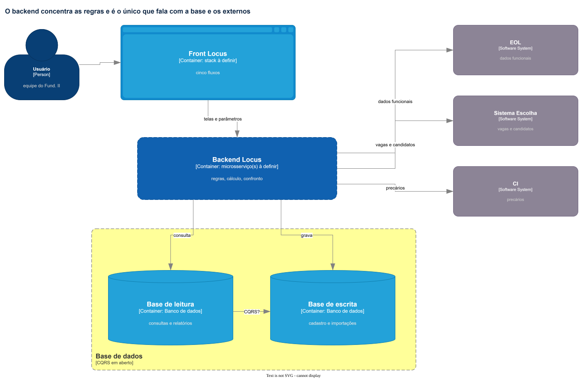
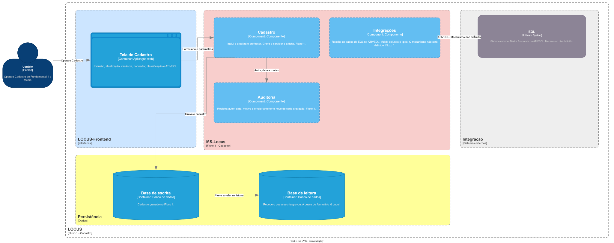
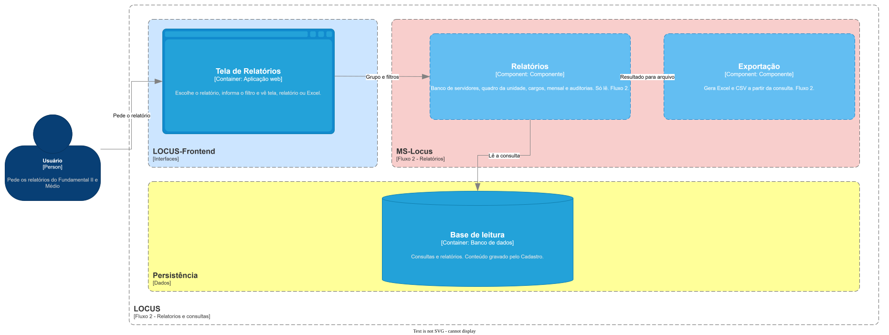
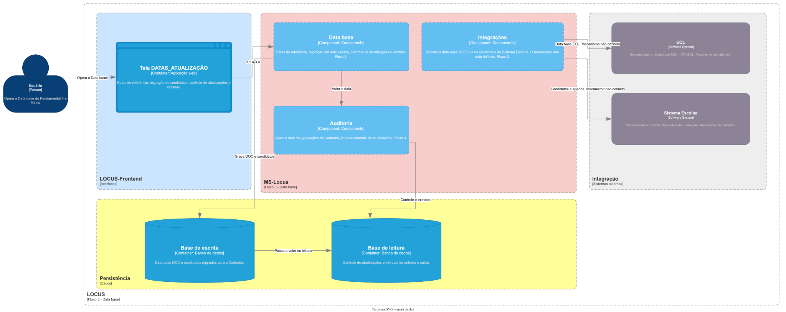
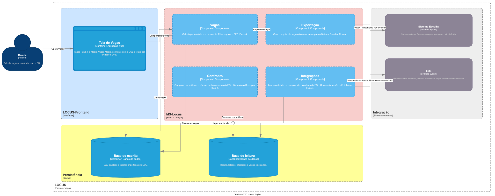
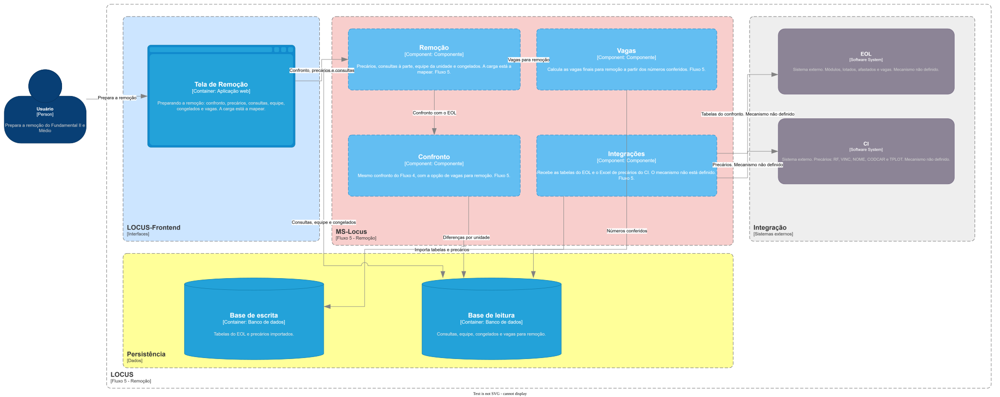

# Fundamental II e Médio

**Fonte:** levantamento *Locus – Fundamental II e Médio: fluxo, containers e componentes* (Jessica Oliveira, 05/11/2026).
**Backend:** MS-Locus.

O módulo tem cinco fluxos: Cadastro, Relatórios e consultas, Data base, Vagas e Remoção. O usuário opera pelo front. O MS-Locus aplica a regra e é quem acessa a base de escrita, a base de leitura e os sistemas externos.

EOL, Sistema Escolha e CI são sistemas externos. A forma da integração com eles não está definida. Até lá, o acesso é do MS-Locus.

Este recorte descreve os cinco fluxos.

---

## Contexto

O backend concentra as regras e é o único que fala com a base e os sistemas externos.



| Elemento | Tipo | Papel |
| --- | --- | --- |
| Usuário | Pessoa | Equipe do Fund. II. Opera o front |
| Front Locus | Aplicação web | Cinco fluxos. Envia telas e parâmetros ao backend. Stack à definir |
| Backend Locus | Serviço | Regras, cálculo e confronto. Microsserviço(s) à definir. Consulta a leitura, grava na escrita e acessa os externos |
| Base de leitura | Banco | Consultas e relatórios |
| Base de escrita | Banco | Cadastro e importações |
| EOL | Sistema externo | Dados funcionais |
| Sistema Escolha | Sistema externo | Vagas e candidatos |
| CI | Sistema externo | Precários |

As duas bases ficam no mesmo grupo. A propagação da escrita para a leitura está em aberto (CQRS?). A forma da integração com EOL, Sistema Escolha e CI não está definida.

---

## Fluxo 1 — Cadastro

Inclui e mantém cargo, lotação, exercício, afastamento, movimentação e classificação do professor. É a fonte dos outros fluxos.

Entrada: Fundamental II > Cadastro. Dois grupos, Inclusão e Atualização, e os botões Consulte ou atualize por classificação e ATIVEOL.

1. O usuário escolhe a operação.
2. O front pede o parâmetro: RF, código da unidade ou número do título de nomeação. Sem parâmetro não há busca.
3. O MS-Locus lê a base de leitura. Por RF, devolve o servidor e os vínculos. Por unidade, a lista da unidade. Por título, os servidores do ato.
4. O front abre o formulário Cadastro de Atualização no primeiro registro. Em lista, o usuário navega com Anterior e Próximo.
5. O usuário altera os campos. Obrigatórios: Local, Cargo atual, Atividade, Tipo de vaga ocupada, Data do retorno do afastamento e Doc fim base.
6. O usuário informa o Motivo da atualização e a Data atualização doc.
7. O MS-Locus valida e grava na base de escrita, com autor, data e motivo.
8. A gravação passa a valer na base de leitura.

| Grupo | Operação | Parâmetro | Efeito |
| --- | --- | --- | --- |
| Inclusão | Substituição, 1º e 2º passo | a mapear | Registra a substituição em duas etapas |
| Inclusão | Cargo vago, 1º e 2º passo | a mapear | Registra o professor em cargo vago em duas etapas |
| Inclusão | Atualizar por RF | RF | Abre o formulário para completar a inclusão |
| Atualização | Por unidade de exercício | Código da unidade | Atualização em lote, registro a registro |
| Atualização | Por unidade de lotação | Código EOL de lotação | Atualização em lote, registro a registro |
| Atualização | Sem RF ou código da unidade | a mapear | Atualização sem as chaves usuais |
| Atualização | Tornar sem efeito | Número do título de nomeação | Anula o ato |
| Atualização | Por RF | RF | Atualização individual |
| Atualização | Vacância | RF | Registra a vacância do cargo |
| Avulso | Norteador | RF | Grava o norteador do vínculo |
| Avulso | Classificação | a mapear | Consulta e ajuste da classificação |
| Avulso | ATIVEOL | a mapear | Conferência com o EOL. O MS-Locus acessa o EOL. O mecanismo não está definido |

O norteador do exemplo (093157) tem o formato do código da lotação. Se é sempre uma unidade está a confirmar.

| Grupo | Campos |
| --- | --- |
| Identificação | Nome, CPF, Local |
| Cargo atual | Código, descrição, Atividade, Tipo de vaga ocupada, Refer, J40 |
| Afastamento | Tipo laudo, Data do retorno do afastamento, Causa do não início, Doc mandado |
| Exercício | Unidade (código, tipo, nome, sigla da DRE), Realocado, Título de nomeação, Item |
| Substituição | Substituindo o efetivo, Substitui liminar |
| Cargo base e lotação | Cargo base, Sit. func. base, Lotação (tipo, código, nome), Tipo lotação, Excedente |
| Datas e documentos | Doc ini. alt., A partir de, Doc fim alt., Fim alt., Doc convocação, Dt. escolha, Doc nomeação, Doc fim base, Fim base, Data atualização doc |
| Classificação | Norteador, Class. geral, DEF, NNA |
| Controle | Motivo da atualização, Liminar |

Saídas: ficha impressa e o cadastro gravado.

### Containers — Cadastro

O usuário opera a tela de Cadastro. O MS-Locus grava na base de escrita e a gravação passa a valer na base de leitura. O ATIVEOL sai do MS-Locus para o EOL.



| Elemento | Tipo | Papel no Fluxo 1 |
| --- | --- | --- |
| Usuário | Pessoa | Opera o Cadastro |
| Tela de Cadastro | Aplicação web | Inclusão, atualização, vacância, norteador, classificação e ATIVEOL. Envia o formulário e os parâmetros |
| Cadastro | Componente do MS-Locus | Inclui e atualiza o professor. Grava o servidor e a ficha |
| Integrações | Componente do MS-Locus | Recebe os dados do EOL no ATIVEOL. O mecanismo não está definido |
| Auditoria | Componente do MS-Locus | Registra autor, data, motivo e o valor anterior e novo de cada gravação |
| Base de escrita | Banco | Cadastro gravado |
| Base de leitura | Banco | Recebe o que a escrita gravou. A busca do formulário lê daqui |
| EOL | Sistema externo | Dados funcionais do ATIVEOL |

---

## Fluxo 2 — Relatórios e consultas

Consulta e emite relatórios dos professores do módulo. Só lê. Não grava.

Entrada: Fundamental II > Relatórios / Consultas.

1. O usuário escolhe o relatório.
2. Quando há filtro, o front pede o parâmetro. Os filtros de cada relatório estão a mapear.
3. O MS-Locus consulta a base de leitura.
4. O front exibe em tela, relatório ou Excel, conforme o pedido.

| Grupo | Relatório | Conteúdo | Saída |
| --- | --- | --- | --- |
| Banco de servidores | Banco inteiro | Todos os professores do módulo | Tela |
| Banco de servidores | Banco inteiro só ativos | Apenas os ativos | Tela |
| Banco de servidores | Vanciados | Professores com vacância. Conteúdo a confirmar | Tela |
| Quadro da unidade | Equipe | Equipe de uma unidade | Excel ou relatório |
| Quadro da unidade | Trabalhos | a mapear | a mapear |
| Cargos | Efetivo | Professores efetivos | Consulta |
| Cargos | Vagas do efetivo | Vagas dos efetivos | Consulta |
| Cargos | Não efetivo | Não efetivos | Consulta, totais e relatório |
| Cargos | Adjunto | Professores adjuntos | Consulta, totais e relatório |
| Relatório mensal | Dados do mensal | a mapear | a mapear |
| Auditorias | Auditorias | a mapear | a mapear |

### Containers — Relatórios

O usuário pede o relatório. O MS-Locus só lê a base de leitura. Não há sistema externo neste fluxo.



| Elemento | Tipo | Papel no Fluxo 2 |
| --- | --- | --- |
| Usuário | Pessoa | Pede o relatório |
| Tela de Relatórios | Aplicação web | Escolhe o relatório, informa o filtro e exibe tela, relatório ou Excel |
| Relatórios | Componente do MS-Locus | Banco de servidores, quadro da unidade, cargos, mensal e auditorias. Só lê |
| Exportação | Componente do MS-Locus | Gera Excel e CSV a partir da consulta |
| Base de leitura | Banco | Consultas e relatórios. Conteúdo gravado pelo Cadastro |

---

## Fluxo 3 — Data base

Controla as datas de referência das cargas, migra para o Locus os candidatos nomeados vindos do Sistema Escolha e acompanha as atualizações e a movimentação de professores.

Entrada: Fundamental II > Data base, que abre a tela DATAS_ATUALIZAÇÃO.

### 3.1 Datas de referência

1. A tela exibe a Data base EOL = ATIVEOL (data da última carga do EOL; a primeira foi em 03/01/2014) e a Checagem de módulo (data da última checagem).
2. O usuário informa a Data base DOC no calendário.
3. O MS-Locus grava a Data base DOC na base de escrita.

Como a data base do EOL é atualizada e o que a checagem de módulo verifica estão a mapear.

### 3.2 Migração de candidatos

Dois passos. A lista vem do Sistema Escolha. O mecanismo não está definido.

1. A tela mostra a Data base agenda, que é a data de nomeação carregada do Sistema Escolha.
2. No 1º passo, o usuário importa e consulta a lista de candidatos.
3. O MS-Locus obtém a lista no Sistema Escolha.
4. O usuário confere a lista.
5. No 2º passo, o usuário aciona Acrescenta migração.
6. O MS-Locus grava os candidatos como novos registros do Cadastro na base de escrita.

### 3.3 Controle de atualizações

1. O usuário escolhe Relatório, Σ No dia ou Σ No mês.
2. O MS-Locus consulta na base de leitura o registro das gravações do Cadastro (autor e data).
3. A tela exibe quem atualizou e o total de atualizações no dia ou no mês.

### 3.4 Extratos de entrada e saída

1. O usuário escolhe o extrato: Efetivo ou Não efetivo, Entrada ou Saída, nominal ou total (Σ). Também há os totais mensais Efetivos total, Efetivos e Não efetivos.
2. O MS-Locus consulta na base de leitura as entradas e saídas de professores no período.
3. A tela exibe a lista nominal ou os totais por mês.

Cada extrato tem dois botões nominais. A diferença entre eles está a mapear.

Saídas: datas de referência gravadas, candidatos migrados para o Cadastro, controles de atualização e extratos.

### Containers — Data base

O usuário opera a tela DATAS_ATUALIZAÇÃO. O MS-Locus grava a Data base DOC e os candidatos na base de escrita. O controle e os extratos leem a base de leitura. EOL e Sistema Escolha são acessados pelo MS-Locus. O mecanismo não está definido.



| Elemento | Tipo | Papel no Fluxo 3 |
| --- | --- | --- |
| Usuário | Pessoa | Opera a Data base |
| Tela DATAS_ATUALIZAÇÃO | Aplicação web | Datas de referência (3.1), migração (3.2), controle (3.3) e extratos (3.4) |
| Data base | Componente do MS-Locus | Mantém as datas, migra os candidatos em dois passos e consulta controles e extratos |
| Integrações | Componente do MS-Locus | Recebe a data base do EOL e a lista de candidatos do Sistema Escolha. O mecanismo não está definido |
| Auditoria | Componente do MS-Locus | Autor e data das gravações do Cadastro, lidos no controle |
| Base de escrita | Banco | Data base DOC e candidatos migrados |
| Base de leitura | Banco | Controle de atualizações e extratos |
| EOL | Sistema externo | Data base EOL = ATIVEOL |
| Sistema Escolha | Sistema externo | Candidatos e data de nomeação |

---

## Fluxo 4 — Vagas e confronto com o EOL

Calcula as vagas de professores por componente curricular e por unidade, exporta para o Sistema Escolha e confronta os números com o EOL.

Entrada: Fundamental II > Vagas, que abre a tela VAGAS – TODAS AS UNIDADES. Quatro opções: Vagas Fund. II e Médio, Vagas Médio, Confronto com EOL e Módulo/lotados/afastados/vagas (total por unidade e por DRE).

### 4.1 Cálculo de vagas

A vaga é calculada por unidade e componente. A fórmula abaixo bate com os exemplos do levantamento e precisa ser validada com a área:

```text
Vagas = Módulo - (Lotados definitivos + Lotados precários) + Afastados
```

O módulo é a quantidade de professores que a unidade comporta no componente. Vaga negativa indica mais lotados do que o módulo. LMD, excedentes (EXC), NEC e vagas em trânsito aparecem nas telas e não alteraram o resultado nos exemplos. O papel de cada um está a mapear.

### 4.2 Consulta de vagas por componente

1. O usuário escolhe o ensino: Fund. II e Médio (8 componentes, para escolha durante o ano) ou Ensino Médio (14 componentes).
2. Na linha do componente, escolhe a ação: Quem?, relatório do cargo, Todas, Só positiva, P/ingresso Σ, Escolha, consulta ou relatório de vagas.
3. O MS-Locus lê na base de leitura o módulo, os lotados e os afastados de cada unidade do componente e calcula as vagas.
4. A tela exibe o resultado. Em Todas aparecem todas as unidades. Em Só positiva, só as com vaga maior que zero. Em P/ingresso, o total para ingresso.
5. Quando o usuário ajusta o campo EXC de uma unidade, o MS-Locus grava o valor na base de escrita e recalcula as vagas.

O relatório de vagas lista, por unidade: código, DRE, tipo, nome, Módulo, Lot. def., Lot. prec., Afast. ou NEC, LMD, Afastados, EXC e Vagas. A pasta do componente traz os totais da rede, mais Total def. + prec. e Vagas em trânsito.

| Ensino | Componentes (código do cargo) |
| --- | --- |
| Fund. II e Médio | Arte (3336), Ciências (3255), Ed. Física (3263), Geografia (3271), História (3280), Inglês (3344), Matemática (3301), Português (3298) |
| Ensino Médio | Biol. Prog. Saúde (3840), Cont. Custos (3816), Dir. e Legisl. (3870), Espanhol (3883), Estr. Func. Ens. 1º Gr. (3873), Filosofia (3874), Física (3859), Hist. Filos. Educ. (3877), Prot. Dentária (3878), Psicologia (3880), Química (3867), Soc. Educ. (3879), Adm. Controle (3808), Sociologia (3884) |

### 4.3 Exportação para o Sistema Escolha

1. O usuário aciona Escolha no componente.
2. O MS-Locus gera o arquivo de vagas.
3. Fora do sistema, o usuário abre o arquivo, acerta as vagas DEF/PREC, exclui as colunas depois da coluna S (tipo, desloc. e sigla) e salva em CSV separado por vírgula.
4. O usuário envia o CSV ao Sistema Escolha.

Os passos 3 e 4 são manuais hoje. O mecanismo de envio não está definido.

### 4.4 Confronto com o EOL

1. Fora do sistema, o usuário exporta do EOL a tabela de cada componente e limpa a tabela.
2. O MS-Locus importa a tabela na base de escrita, com o nome do componente seguido de MOU (ARTEMOU, BIOLOGIAMOU, CIENCIASMOU, EDFISICAMOU, ESPANHOLMOU, FILOSOFIAMOU, FISICAMOU, GEOGRAFIAMOU, HISTORIAMOU, INGLESMOU, MATEMATICAMOU, PORTUGUESMOU e as demais).
3. O usuário escolhe o tipo de confronto (Módulos, Lotados definitivos, Afastados ou Vagas para escolha) e o componente.
4. O MS-Locus compara, por unidade, o número do Locus com o do EOL.
5. A tela exibe só as escolas com diferença, agrupadas por DRE e marcadas como DIFERENTE.
6. O usuário corrige o dado no Cadastro ou no EOL.

As telas citam o Mourão como referência do confronto. O sufixo MOU parece vir daí. O que o Mourão é está a mapear. No confronto de lotação há casos marcados como diferentes em que Lot. EOL + TRDEF EOL é igual a Lot. nosso. Essa regra está a mapear. A opção Módulo/lotados/afastados/vagas mostra os números do EOL sem comparar.

Saídas: vagas por unidade e componente, arquivo para o Sistema Escolha e listas de divergências com o EOL.

### Containers — Vagas

O usuário consulta as vagas por componente. O MS-Locus calcula a partir da base de leitura, grava o EXC na base de escrita, gera o arquivo para o Sistema Escolha e confronta com o EOL.



| Elemento | Tipo | Papel no Fluxo 4 |
| --- | --- | --- |
| Usuário | Pessoa | Consulta vagas, exporta e confronta |
| Tela de Vagas | Aplicação web | Vagas Fund. II e Médio, Vagas Médio, confronto com o EOL e totais por unidade e DRE |
| Vagas | Componente do MS-Locus | Calcula por unidade e componente. Filtra e grava o EXC |
| Exportação | Componente do MS-Locus | Gera o arquivo de vagas do componente |
| Confronto | Componente do MS-Locus | Compara, por unidade, o número do Locus com o do EOL e lista só as diferenças |
| Integrações | Componente do MS-Locus | Importa a tabela do componente vinda do EOL. O mecanismo não está definido |
| Base de escrita | Banco | EXC ajustado e tabelas importadas |
| Base de leitura | Banco | Módulo, lotados, afastados e vagas calculadas |
| Sistema Escolha | Sistema externo | Recebe as vagas. O mecanismo não está definido |
| EOL | Sistema externo | Módulos, lotados, afastados e vagas por componente |

---

## Fluxo 5 — Remoção

Audita e prepara os dados do concurso de remoção: confronto com o EOL, precários, afastamentos e números congelados. Gera as vagas para remoção. A carga está a mapear.

Entrada: Fundamental II > Remoção. Duas opções: Preparando a remoção, que abre a tela AUDITORIAS PERÍODO REMOÇÃO FUNDAMENTAL II, e Carga da remoção (a mapear).

A tela não impõe ordem. A sequência abaixo segue a organização dos blocos e precisa ser validada.

### 5.1 Confronto com o EOL

1. O usuário segue a mesma preparação do Fluxo 4.4: exporta, limpa e o MS-Locus importa as tabelas com sufixo MOU.
2. O usuário aciona Confronto com EOL de módulos, lotados, afastados e vagas para remoção.
3. O MS-Locus executa o mesmo confronto do Fluxo 4.4. A opção de vagas aparece como "para remoção".
4. A tela exibe as escolas com diferença.

| Confronto | Relatório | Colunas |
| --- | --- | --- |
| Módulos | a mapear | a mapear |
| Lotados definitivos | CHECANDO_LOTAÇÃO_\<componente\> | Lot. nosso, Lot. EOL, TRDEF EOL, Situação. Há o botão Listar professores |
| Afastados | CHECANDO_AFASTADOS_\<componente\> | Afast. nosso, Afast. EOL, Situação |
| Vagas | CHECANDO_VAGAS_\<componente\> | Vagas nosso, Vagas EOL, Situação |

### 5.2 Precários

1. O CI envia um Excel com os professores precários. O mecanismo não está definido.
2. O arquivo precisa ter os campos RF, VINC, NOME, CODCAR e TPLOT, com estes nomes, em texto.
3. O MS-Locus importa o arquivo na base de escrita.
4. O usuário escolhe Confronto precários por cargo, Confronto precário todos os cargos ou Precários – nosso, cada um com relatório e consulta.
5. O MS-Locus compara os precários do CI com os do Locus. O Locus tem precários que o CI não tem. Todos precisam ser conferidos para serem inscritos nas etapas da remoção.

### 5.3 Consultas à parte

1. O usuário escolhe a consulta e a ação (Quem? ou relatório).
2. O MS-Locus consulta os professores na base de leitura.
3. A tela exibe a lista com Total, ATIVTRAB, DOCINIALT, RF, CL, VIN, Nome, CODCAR, DESCAR, DESCFU, Lotação, Tipo e Desloc.

| Consulta | O que lista |
| --- | --- |
| Afastado perde lotação | Afastados que saíram da unidade. Aparecem lotados na unidade 120235 (COGEP, Seção de Controle de Pessoal) |
| Retorno de afastamento no ano | a mapear |
| Outros afastamentos | Afastamentos sindicais, para assembleia e para câmara, mantendo a unidade de origem |
| Liminar | a mapear |

### 5.4 Equipe da unidade

1. O usuário aciona Equipe_EM relatório.
2. A tela pede o código da unidade de lotação.
3. O MS-Locus lista a equipe da unidade na base de leitura.

### 5.5 Congelados

1. Congelado EOL abre os módulos, lotados, afastados e vagas constantes no EOL, por componente.
2. Congelado nosso abre a tela de vagas do Locus, com todas as unidades.
3. O MS-Locus lê na base de leitura a fotografia dos números no período da remoção.

Como e quando o congelamento é feito está a mapear.

### 5.6 Vagas para remoção

1. O usuário aciona Vagas para remoção, no bloco Final nosso, com filtro.
2. O MS-Locus calcula as vagas finais a partir dos números conferidos.
3. A tela exibe as vagas para remoção.

### 5.7 Carga da remoção

A mapear.

Saídas: divergências com o EOL e com o CI, listas de afastamentos, números congelados e vagas para remoção.

### Containers — Remoção

O usuário prepara a remoção. O MS-Locus repete o confronto do Fluxo 4, importa os precários do CI, consulta a base de leitura e calcula as vagas finais. A carga da remoção está a mapear.



| Elemento | Tipo | Papel no Fluxo 5 |
| --- | --- | --- |
| Usuário | Pessoa | Prepara a remoção |
| Tela de Remoção | Aplicação web | Confronto, precários, consultas, equipe, congelados e vagas. A carga está a mapear |
| Remoção | Componente do MS-Locus | Precários, consultas à parte, equipe da unidade e congelados |
| Vagas | Componente do MS-Locus | Calcula as vagas finais a partir dos números conferidos |
| Confronto | Componente do MS-Locus | Mesmo confronto do Fluxo 4, com vagas para remoção |
| Integrações | Componente do MS-Locus | Recebe as tabelas do EOL e o Excel de precários do CI. O mecanismo não está definido |
| Base de escrita | Banco | Tabelas do EOL e precários importados |
| Base de leitura | Banco | Consultas, equipe, congelados e vagas para remoção |
| EOL | Sistema externo | Módulos, lotados, afastados e vagas |
| CI | Sistema externo | Precários: RF, VINC, NOME, CODCAR e TPLOT |
